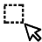
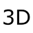
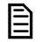
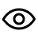
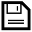

# Image processing

## Introduction

In this tutorial, you will work through some of the key steps used to process structural brain MRI data. The aim is to become familiar with a basic neuroimaging workflow and to understand what each processing step does, why it is needed, and how it affects the resulting images.

We will focus on three main tasks: **brain extraction**, where we remove non-brain tissue from the MRI; **image registration**, where we align brain images to a common reference space; and **segmentation**, where we identify different brain tissues and deep brain structures.

For each step, you will run the relevant tools, inspect the outputs, and consider whether the processing has worked correctly. By the end of the tutorial, you should have a better understanding of how a raw structural MRI can be transformed into data that are ready for further neuroimaging analysis.

By the end of this tutorial, you should be able to **perform and visually assess brain extraction, image registration, and tissue and deep brain structure segmentation**, and explain why these steps are important in a structural MRI processing workflow.

## Brain extraction

Brain Extraction is a crucial step in many analysis pipelines - particularly for structural analysis involving segmentation, where an accurate brain extraction is important. It is also important for registration, but in this case the brain extraction does not have to be highly accurate, and small errors are fine. Running BET, to perform the brain extraction, is very easy to do, but getting highly accurate results can involve some skill and patience.

### Starting the GUI

Start by opening a terminal and going to the correct directory:

```bash
cd ~/fsl_course_data/intro
```

Most FSL programs can be run from the command-line without using a GUI, by typing fully lowercase names (e.g. ```bet```). Many programs also have a GUI, which can be started via the FSL mini-GUI (type ```fsl```) or by typing a capitalised version of the command name (e.g. ```Bet```).

> [!NOTE]
> Note that on Mac OS, the command line call to the GUI has _gui appended (e.g. Bet_gui).

Start the ```fsl``` GUI and click on BET, to see how this all works. Now exit both of these GUIs and start the Bet GUI directly from the terminal (note: use ```&``` after the command to make it run in the background, e.g. ```bet &```).

### Running BET

Using the Bet GUI, set the input file to ```structural.nii.gz``` use the right-hand file selector button rather than typing this in by hand as it minimises the chances of errors. Turn on various optional outputs (brain extracted image, binary brain mask and skull surface image - see Advanced Options tab) but leave the other settings as they are. Note that the GUI suggests the default output name ```structural_brain```.

When done click on **Go** to run BET and then exit the GUI once it's done. You will see that when you pressed Go the actual command carried out was printed in the terminal; many of the FSL GUIs will do this, in order to help you see what's actually going on. Also in the terminal you will see Finished appear once BET has finished running (you may need to hit return to get a visible prompt back after seeing "Finished").

Use ```ls -lrt``` to see what files got created and view the various outputs (this sorts the files according to file creation date, with the most recent at the bottom, making it very easy to see what the most recently created files in a directory are). 

> [!NOTE]
> If this does not give any output then your GUI is probably not running in the background, but you can still make it run in the background by pressing ```control z```, and then typing ```bg``` in the terminal (and after this you can run the ```ls``` command).

### Viewing the results

View the brain mask overlaid onto the original image by first loading the original image into FSLeyes and then adding the mask image.

```bash
fsleyes structural.nii.gz structural_brain_mask.nii.gz &
```

> [!NOTE]
> Starting FSLeyes for the first time might be a bit slow.

Change the transparency and colour of the overlay so that you can get a better view of the success of the brain extraction. Remember that for registration purposes the brain extraction can contain some small errors, but if you were going to use it for segmentation purposes then it would need to be much more accurate.

### Varying the fractional intensity threshold parameter (-f)

The usage for the command-line version of bet is:
```bash
bet <input> <output> [options]
```
where ```input``` and ```output``` stand for filenames and options can be many, or none, of the available extra options.

You can just type ```bet``` to see the usage description (first line of the output) as well as a description of the many options available. Have a look at the command that the GUI printed in the terminal when you pressed OK previously, which gives an example of how it works.

Using the command line, try setting the Fractional intensity threshold (the ```-f``` option on the command line) to ```0.2``` and ```0.8```, in turn, to see the effect it has (save these with different output image names and load both into FSLeyes). This option controls the threshold that distinguishes brain from non-brain; if you reduce it from the default value of 0.5 then the brain estimate gets larger, and vice versa.


## Image Registration

In this section you will explore each of the registration steps within a standard two-step registration for functional images. We will first learn to use the registration tools within the FEAT GUI. Then we will see how to apply and invert transformations. Being able to achieve precise registrations is CRUCIAL for structural, functional and diffusion image analysis. If registrations are not accurate, further statistics at a structural or group level will not be accurate.

### Two-stage Registration and Unwarping with FEAT

The objective of this section is to become familiar with how to perform and evaluate the results of registration in the FEAT GUI (the main functional analysis GUI). This involves multi-stage registration and fieldmap-based unwarping, and requires the images to be suitably prepared.

The scans used in this tutorial are acquired using an imaging technique that is now widely adopted, called 'multiband imaging' or 'simultaneous multi-slice'. Multiband imaging allows to acquire functional (or diffusion) images more quickly, allowing more volumes in the functional 4D file for more statistical power, or shortening functional scanning times. When registering multiband scans there are some specific steps involved to optimise the registration, which will be highlighted in the tutorial.

Take a look inside the data directory:

```bash
cd ~/fsl_course_data/registration
ls
```

This directory contains the following images:

1. A structural scan: ```STRUCT.nii.gz```
2. A functional scan: ```FUNC.nii.gz```
3. A magnitude fieldmap image: ```FMAP_MAG.nii.gz```
4. A phase fieldmap image: ```FMAP_PHASE.nii.gz```
5. A text file containing the fieldmap information: ```FMAPS.txt```
6. A folder containing an example registration (```EXAMPLE_REG``` - we will use this a bit later)
7. A folder containing data for the optional section (non_multiband_data)
8. A high-contrast volume to help aid registration: ```CONTRAST_FUNC.nii.gz```

Because multiband images are acquired very quickly, they can have low contrast between grey and white matter. Therefore, to aid registration we can add an additional high-contrast image to our registration between functional and standard spaces. This high-contrast image is usually one of the first few scans ('pre-saturation' scans, also called SBRef = Single Band Reference, i.e., without the simultaneous multi-slice acceleration) acquired in a multiband sequence, which are usually discarded before functional analysis. In every other way it matched the functional scans used in the analysis, so it is a perfect match to the ```FUNC.nii.gz``` image, just with greater contrast between tissues in the brain. 

>[!NOTE]
> Registration of multiband data does not require this step to run, but it is recommended to use this intermediate contrast image for improved registration of multiband images.

### Preparing the structural image

We need to perform brain extraction on the structural image prior to using it for registration (as explained in the lecture). To do this run BET on the image ```STRUCT.nii.gz```, and save the result as ```STRUCT_brain.nii.gz```. Check the results with FSLeyes.

#### Fieldmap images

There are two images that the Siemens scanner saves from a fieldmap sequence. These are (in this case, renamed nicely for you):

```
FMAP_MAG.nii.gz
FMAP_PHASE.nii.gz
```

where the first image represents the standard magnitude image from the fieldmap acquisition, and the second image represents a phase difference (between two different echo times, calculated internally as part of the fieldmap acquisition). The second image is proportional to a map of the distortions. Have a quick look at these with FSLeyes. We will need to use both magnitude and phase images.

#### Processing the fieldmap magnitude image

We will start by brain extracting the first magnitude image. Run brain extraction with BET on the magnitude image and save the result as ```FMAP_MAG_brain.nii.gz```. We will then erode this image (shaving off one voxel from all edges) as this image contains noisy partial volume voxels in the phase difference image near the edge of the brain (you will see this below, whereas in practice you would look first in order to decide whether to erode or not). To do the erosion we run:

```bash
fslmaths FMAP_MAG_brain -ero FMAP_MAG_brain_ero
```

This performs an erosion operation (stripping one voxel from the edge) with the general tool fslmaths which acts as an image calculator, taking input images and performing operations on them and then saving them as a new image (the last name specified). Check what the results look like in FSLeyes:

```bash
fsleyes FMAP_MAG -cm greyscale \
  FMAP_MAG_brain -cm red-yellow \
  FMAP_MAG_brain_ero -cm blue-lightblue &
```

Add the phase (```FMAP_PHASE.nii.gz```) to the viewer to see why we needed to erode the brain in order to avoid the noisy voxels at the edge. Note that the "lost" voxels will have fieldmap values filled in by extrapolating from the nearest voxel inside the mask, which is quite accurate for fieldmaps as the field variations are quite smooth (you cannot see this in these images as it happens in the later processing).

#### Processing the fieldmap phase difference image

Here we need to take this raw scanner output, which is scaled in a strange way (0 to 360 degrees are mapped to 0 to 4096), and convert it into radians per second image (this is equivalent to an image in ```Hz``` multiplied by ```2*π```). For this we need the phase difference image, the brain extracted (and eroded) magnitude image and the difference in the echo times of the fieldmap acquisitions. This latter value is ```2.46ms``` and can be found in the text file ```FMAPS.txt```, which is conveniently given here but will not exist normally. Therefore it is important to record this echo time difference when you scan (your scanner operator will be able to give you the value, and although it can usually be determined later on, it is much easier to record it at the time when the scanner operator is present).

Armed with this information, all we need to do is run the GUI called ```Fsl_prepare_fieldmap```. Note that these images come from a Siemens scanner. Set up all the information required in the GUI, (phase image is ```FMAP_PHASE.nii.gz``` and the brain extracted magnitude image is ```FMAP_MAG_brain_ero.nii.gz```) calling the output ```FMAP_RADS```, and press **Go**. View the output with FSLeyes and check that most of the brain has small values (less than 200 rad/s) while in the inferior frontal and temporal areas the values are larger (either large and positive or large and negative).

#### Using the FEAT GUI

With the fieldmap processed and the structural image brain extracted we are now ready to use the FEAT GUI for registration. Note that the "unwarping" of images using fieldmaps is done in the **Pre-stats** tab of the FEAT GUI.

Start the FEAT GUI by typing ```Feat``` in the terminal. From the drop-down list in the top right corner select **Preprocessing**. We now need to set up the GUI to run our registration with unwarping.

We will start with the main **Data** tab. To begin with click on the **Select 4D data** button and select the image ```FUNC.nii.gz```. Once this is done, click on the file browser for the Output directory and make sure the directory is set to somewhere in your home directory. Then, in the **Selection** box at the bottom type ```test_reg``` and press **OK** (if you leave it empty, it would normally default to something like ```~/fsl_course_data/registration/FUNC.feat```).

Now go to the **Pre-stats** tab and click the **B0 unwarping** button. Note that all other parts of this tab (e.g. motion correction) are set to their default values and we will leave them with these settings. Now go through and populate the relevant parts:

- Fieldmap: ```FMAP_RADS``` (select this using the file browser that the folder icon opens)
- Fieldmap mag: ```FMAP_MAG_brain```
- Effective EPI echo spacing: ```0.57ms``` (taken from the ```FMAPS.txt``` file here, but in general you need to take note of this value when scanning - ask your operator. Note that if you are using parallel acceleration then it needs to be divided by the acceleration factor (which is not the same as the multi-band acceleration factor).
- EPI TE: ```33.4ms```
- Unwarp direction: ```-y``` (again your operator can tell you whether the unwarp direction, or phase encode direction, is x, y or z, but whether it is + or - needs to be determined, currently, by trial and error, which has already been done here)
- % Signal loss threshold: Leave at the default value of ```10%```.
- All other parts of this tab can be left with their default settings.

Go to the Registration tab.

- Click on the **Expanded functional image** button. This is a multiband-specific step, where we input the high-contrast volume to aid the registration. Open the file browser and select ```CONTRAST_FUNC.nii.gz```, then change the degrees of freedom to ```6```. Note that registration does not require this step to run, but it is recommended to use this intermediate contrast image for registration of multiband data.
- Click on the **Main structural image** button. Open the file browser and select ```STRUCT_brain```. Make sure the options underneath are set to ```Normal search``` and ```BBR```.
- In the **Standard space** box, make sure the image ```MNI152_T1_2mm_brain``` is selected in the correct directory. (This reference image is part of FSL. In general, to find out where FSL is installed, type echo ```$FSLDIR``` into a terminal. The standard space reference images are in ```data/standard/``` inside that directory.)
- We will not select the **Nonlinear** button in the Standard space section for this part of the practical in order to save time, but you normally would use this setting as it gives the best results.

OK, that's everything we need to register the functional image to standard space. So double-check that the **Pre-stats** and **Registration** tabs look correct and when you are happy press the **Go** button at the bottom. This should start up a web browser showing the progress of FEAT - although it may take a minute for this to appear.

Now go back to the FEAT GUI, and we are going to run a comparison registration without fieldmap unwarping. So go to the **Pre-stats** tab and de-select the **B0 unwarping** button. In the **Data** tab, re-name the output to something like ```test_reg_no_fmap```. Everything else stays the same, and once you are happy with all the setting press the **Go** button again.

#### While you wait

The FEAT jobs will take about 15 minutes to finish. In the meantime we can have a look at the registration provided in the ```EXAMPLE_REG``` subject directory. Change to this directory, and open the webpage report for the registration:

```bash
cd ~/fsl_course_data/registration/EXAMPLE_REG/example_multiband_reg.feat
firefox report_reg.html &
```

> [!NOTE]
> Although we talk about two-stage registration (functional to structural and structural to standard space), when using multiband data the registration from functional to structural is split into two parts. First we transform ```example_func``` (an example volume from the ```EPI/functional``` data) to the high-contrast volume (referred to as ```initial_highres```), then we transform the high-contrast volume to the structural scan (```highres```). For data acquired without multiband, we register directly the functional scan (```example_func```) to the structural (```highres```), essentially omitting the **Expanded functional image** option, as there is usually enough anatomical contrast in the functional data to drive a good registration.

Look carefully at the results of the registrations in the web page report and in the **Unwarping** page for the cases where fieldmap-based correction was run. Do these registrations seem accurate to you? Note that you should not trust borders with signal loss areas as these are not true anatomical boundaries but artificial borders.

It is also highly recommended to use FSLeyes to look in more detail. We can look at each of the registration steps separately (functional to structural, and structural to standard), but remember when these steps are combined to produce a functional to standard transformation, the functional image is only resampled ONCE into standard space.

Let's first look at the registration step from functional to structural in FSLeyes. Load the structural image into FSLeyes using the following command:

```bash
cd reg
fsleyes highres.nii.gz &
```

This ```highres.nii.gz``` image is created in the reg folder by FEAT from the T1 structural image we specified.

Using the FSLeyes GUI, add the ```example_func2highres.nii.gz``` image (```example_func``` is a distortion-corrected example volume from the ```EPI/functional``` data, and ```example_func2highres``` is the ```example_func``` image transformed into structural space), the ```initial_highres2highres.nii.gz``` (the high-contrast functional image transformed into structural space), and the ```initial_highres2highres_fast_wmedge.nii.gz``` (this image shows the location of the white matter edges, as defined by the highres image). Change the colour map of this wmedge image, by selecting in the image list at the bottom left, and then selecting **Red** in the colour map drop down list at the top of the FSLeyes window.

Click around the image to see where the registration is particularly good (as the red edges derived from the structural should align with the changes the in greyscale intensities of the functional image). Toggle the visibility of the ```example_func2highres``` image on and off (the  button), or adjust its transparency (the **Opacity** slider in the display toolbar at the top of the FSLeyes GUI) to judge its alignment to the highres image.

Feel free to look at other images in this reg subdirectory or in the unwarp subdirectory inside this. For example, the uncorrected registration result is in the file ```unwarp/initial_highres_distorted2highres.nii.gz``` and can be viewed separately or added to the FSLeyes session above.

Now open another FSLeyes session (without closing the old one) from the terminal to view the registration step from structural to standard:

```bash
fsleyes standard.nii.gz &
```

Add the ```highres2standard.nii.gz``` image, which is the structural image transformed into standard space. In this case non-linear registration (FNIRT) was used after affine linear transformation (FLIRT) for maximum accuracy. Use the same FSLeyes tools to check the registration of the structural image to the standard image.

Leave both of these FSLeyes sessions open for the moment, as we are now going to compare the registrations you just ran to these given examples.

#### Once the FEAT job is finished

Firstly, look at your webpage reports for the registrations you ran. Can you spot any noticeable differences compared to the example registration webpage report? We will now compare these registrations carefully using FSLeyes.

Go back to the FSLeyes window where you were looking at the first registration step (functional to structural). Now add the ```example_func2highres.nii.gz``` image from the registration you ran with fieldmap correction (```~/fsl_course_data/registration/test_reg.feat/reg/example_func2highres.nii.gz```). You can also add ```initial_highres2highres.nii.gz``` (multiband-specific step). How does this registration compare to the original? It should be identical, or at least very, very similar.

Now add the registration you ran WITHOUT fieldmaps (```~/fsl_course_data/registration/test_reg_no_fmap.feat/reg/example_func2highres.nii.gz```). You may wish to rename this image within FSLeyes to something like ```example_func2highres_no_fmap.nii.gz``` to avoid confusion (as FSLeyes will initially give both images the same name). Use the FSLeyes tools you practised earlier to compare the registrations with and without fieldmaps.

Now go to the FSLeyes window where you were looking at the second registration step (structural to standard). Add the ```highres2standard.nii.gz``` image from the registration you ran (```~/fsl_course_data/registration/test_reg.feat/reg/highres2standard.nii.gz```). This registration step was done linearly (using FLIRT) rather than non-linearly (using FNIRT, as in the example provided). Compare the linear and linear+non-linear versions of this step.

Finally, de-select (or remove) the ```highres2standard``` images within the FSLeyes session. Add the combined registration images from the supplied example using both fieldmaps and non-linear registration (```~/fsl_course_data/registration/EXAMPLE_REG/example_multiband_reg.feat/reg/example_func2standard.nii.gz```) and the registration you ran without fieldmaps or non-linear registration (```~/fsl_course_data/registration/test_reg_no_fmaps.feat/reg/example_func2standard.nii.gz```). You may need to rename these within FSLeyes to avoid confusion. The registration without fieldmap correction or non-linear registration will be markedly worse than the original registration, as both sub-optimal registration steps have now been concatenated into one step.

### Applying and Inverting Transformations

The objective of this section of the tutorial is to become familiar with applying transformations, as well as their inverses, to move masks (or images) between different spaces. This is very useful as although FEAT, Featquery and FDT do a lot of this "behind the scenes" for you, there will be many cases when you want to do something beyond the standard options and then you'll need to be able to do this for yourself.

We will be working with the files from the Feat analysis in the previous part of the tutorial, however what we are doing is not restricted to functional analysis. FDT outputs similar files when analysing diffusion datasets, and the same files (affine transformation matrices and warp fields) are output by the fundamental tools, FLIRT and FNIRT, when doing any structural analyses.

#### Transformation files

If you look in the example registration directory you will see many different files:

```bash
cd ~/fsl_course_data/registration/EXAMPLE_REG/example_multiband_reg.feat/reg/
ls
```

The crucial ones for registration purposes are the transformation files that come in two different varieties: affine matrices (ending with ```.mat```) and warp fields (ending with ```_warp.nii.gz```). For now we will not look at the contents of these files but instead we will explain what each of them means.

The naming convention is always from the input space to the reference space (or source to destination if you prefer). For example, the file ```highres2standard.mat``` is an affine transformation going from the highres (structural) space to the standard (MNI) space. There is also the file ```highres2standard_warp.nii.gz``` that represents a non-linear warp from highres space to standard space. We have both of these because it is necessary to initialise all non-linear registrations with an affine registration (that gets the head in roughly the right position and scaling to allow the non-linear registration to work well). When you want to use a transformation between these spaces, you would generally go for the warp field (when it exists) and ignore the initial affine registration. Note that the warp fields include the affine transformation as part of them, so you don't need to use both.

There are three main spaces in a FEAT analysis: functional (represented by ```example_func```); structural (represented by ```highres```); and MNI (represented by ```standard```). Various combinations of transformations exist in this directory (e.g. ```example_func2highres```, ```example_func2standard```, ```highres2standard```) but not all (e.g. ```standard2highres```). Note that in a diffusion analysis, run via FDT, the three spaces are called diff, str and standard, and all combinations of transformations are provided.

One thing that might confuse you is why there exists ```example_func2highres_warp.nii.gz``` when BBR (which performs linear registration) was run to do the registration of functional to structural images. This is because of the fieldmap-based distortion correction, which is not just a linear (affine) registration and so must be represented as a warp field.

#### Creating an example mask

Now let's make a mask in the standard (MNI) space so that we can transform it into the other spaces and use it to calculate some ROI quantities. We will do this using FSLeyes - type in ```fsleyes -std &``` to get started.

Once FSLeyes is open, select the **Settings** > **Ortho View 1** > **Atlases** menu option. This will open up a new panel along the bottom of the FSLeyes GUI that allows you to look at anatomical information from the atlases included with FSL. We can use these atlases to create a mask image (we will choose the left hippocampus from the Harvard-Oxford subcortical atlas, but there are lots of possibilities).

Click the **Atlas search** tab. Type ```hip``` into the search box at the top of the right section - note that as you type, all atlases, in the atlas list to the left, which contain a structure that matches the search term, are highlighted. Click the checkbox next to the Harvard-Oxford Subcortical Structural Atlas to add it as an overlay. Then, in the structure list on the right, click the ```+``` button by the Left Hippocampus entry, to move the cursor location to this structure.

Now we are going to select the voxels in the left hippocampus.

1. Click on the atlas image in the list of overlays to make it the active layer
2. Turn on edit mode (*Tools > Edit mode*). Two new toolbars will be added to the FSLeyes window.
3. On the toolbar along the top:
    - Click the selection mode button 
    - Click the select-by-intensity button 
    - Enable 3D selection 
    
    Now we are able to select regions of voxels according to their intensity.
4. Click anywhere in the left hippocampus structure to select all of the voxels within it. You may need to adjust the intensity threshold slide bar.
5. On the toolbar running down the left hand side, click the *Create mask* button (), to copy this selection to a new mask image.

A new image will be added to FSLeyes, with ones in the left hippocampus, and zeros everywhere else. Exit edit mode (*Tools > Edit* mode), and toggle the visibility of the Harvard Oxford subcortical atlas (the  button in the overlay list) so you can see your new mask image better.

We will now save this mask image out to a file in the directory ```~/fsl_course_data/registration/EXAMPLE_REG/example_multiband_reg.feat/reg```. Click on the save button  alongside the mask image in the overlay list, and choose an appropriate name (e.g. ```LeftHippMask```). To make life a lot easier later on make sure you remove all spaces from the filename. This is a general rule to stick with, as spaces within filenames will almost always cause problems and are easily avoided.

#### Inverting a transform

We want to transform the mask we just made into the functional space in order to calculate an ROI value (e.g. of a statistical image, or an average timecourse, etc.). To go from the standard space to the functional space we would need to have the transformation ```standard2example_func_warp.nii.gz``` (or something named like this). In FEAT this does not exist, but in FDT the equivalent is generated automatically, and called ```standard2diff_warp.nii.gz```.

As Feat does not create the required warp field, we need to create it ourselves from the transformations that it does provide. In this case we do not want to undo the distortion correction (i.e. we want a mask in distortion-corrected functional space). For the structural-to-functional transform we therefore only need ```highres2example_func.mat``` which was already created by FEAT. We do need to calculate the non-linear standard-to-structural transform, which can easily be done using the ```invwarp``` command, as follows:

```bash
# We have already run this for you, to save some time in the
# tutorial session, so there is no need to run it again.
invwarp -w highres2standard_warp -o standard2highres_warp -r highres
```

where the final part (the reference) controls the size (FOV) and resolution of the warp and should generally be the destination space of the new transform. As this warp transforms from standard space to structural (we will stick on the final transformation to functional space below), we specify ```highres```.

#### Applying a transformation

Now that we have the transformation that we need, we can apply it using the ```applywarp``` command, by specifying a warp (```-w```). The command you need is (with your own filenames):

```bash
applywarp -i LeftHippMask -r example_func -o LeftHippMaskFunc \
  -w standard2highres_warp --postmat=highres2example_func.mat
```
which goes from the standard space via the highres space to the example_func space (the last part only needing a rigid-body transformation matrix, as we want to end up in the distortion-corrected functional space, rather than the original distorted one).

For visual check use the command:

```bash
fsleyes example_func LeftHippMaskFunc &
```

to see the mask on the functional image. Note that the values at the edge of the mask lie between 0 and 1.

In order to obtain a binary mask (where each voxel has a value of either 0 or 1) we need to threshold and binarise the transformed mask. This is easily done with fslmaths but the threshold used is arbitrary. If a high threshold is chosen (e.g. 0.9) then most edge voxels will be excluded and the mask will be tighter and less likely to include neighbouring structures. This is often desirable when trying to make sure that only the structure of interest is included, but it might end up with the mask being quite small. So sometimes a threshold near 0.5 is preferable, to make a mask of similar size/volume. Or sometimes a mask is needed that does not leave out any of the structure, in which case a low threshold (e.g. 0.1) can be better. We also binarise the mask with the ```-bin``` command in ```fslmaths```, to make all voxels within the mask have a value of 1. In this case we will choose a high threshold in order to get a mask where we are very confident that each voxel in the mask is within the hippocampus. This can be done with:

```bash
fslmaths LeftHippMaskFunc -thr 0.9 -bin LeftHippMaskFuncBin
```

Load the resulting image into FSLeyes and compare it to the original, pre-thresholded version in the functional space.

There are many possible ways in which a mask can be used (e.g. getting average statistical values) but as an example will we calculate the average timecourse of the fMRI within this mask. This is done with the command:

```bash
fslmeants -i ../filtered_func_data -m LeftHippMaskFuncBin
```

which will output a column of numbers, representing the timecourse of the average signal intensity (of the pre-processed fMRI data) within this mask. We won't do anything with this for now, but such calculations can be very useful in all sorts of situations.

The main point of this exercise was to see how to transform your own masks (or images, as the only difference is skipping the thresholding and binarising steps) between spaces. For functional studies you can often do similar things with the tool Featquery but it is not as flexible and generally useful as being able to process things yourself.

### Image Registration with ANTs

This tutorial demonstrates how to register a structural MRI image to the **MNI152 1 mm standard-space brain** using ANTs.

We will use:

- **Fixed image:** `~/fsl/data/standard/MNI152_T1_1mm_brain.nii.gz`
- **Moving image:** `~/fsl_course_data/registration/STRUCT_brain.nii.gz`

The fixed image defines the target space. Therefore, the goal is to transform `STRUCT_brain.nii.gz` into MNI152 space.

#### 1. Run the Registration

ANTs provides `antsRegistrationSyNQuick.sh`, a convenient wrapper around `antsRegistration`.

Run:

```bash
mkdir ~/fsl_course_data/registration/ants

cd ~/fsl_course_data/registration/ants

antsRegistrationSyNQuick.sh \
    -d 3 \
    -f ~/fsl/data/standard/MNI152_T1_1mm_brain.nii.gz \
    -m ~/fsl_course_data/registration/STRUCT_brain.nii.gz \
    -o STRUCT_to_MNI_ \
    -t s
```

The main options are:

| Option | Meaning |
|---|---|
| `-d 3` | Perform 3D registration |
| `-f` | Fixed image (MNI152 template) |
| `-m` | Moving image (subject structural image) |
| `-o` | Prefix for output files |
| `-t s` | Rigid + affine + nonlinear SyN registration |

The registration proceeds through increasingly flexible transformations: **rigid → affine → nonlinear SyN**.

#### 2. Registration Outputs

After registration, several files will be created in the current directory. The most important are:

| File | Purpose |
|---|---|
| `STRUCT_to_MNI_0GenericAffine.mat` | Linear transformation |
| `STRUCT_to_MNI_1Warp.nii.gz` | Nonlinear deformation field |
| `STRUCT_to_MNI_1InverseWarp.nii.gz` | Inverse nonlinear deformation |
| `STRUCT_to_MNI_Warped.nii.gz` | Structural image transformed into MNI space |

The easiest result to inspect initially is:

```text
STRUCT_to_MNI_Warped.nii.gz
```

Compare this image with:

```text
~/fsl/data/standard/MNI152_T1_1mm_brain.nii.gz
```

The major anatomical structures and tissue boundaries should align closely.

#### 3. Apply the Transformation to Another Image

The transformations calculated during registration can be reused without repeating the registration.

For example:

```bash
antsApplyTransforms \
    -d 3 \
    -i ~/fsl_course_data/registration/STRUCT_brain.nii.gz \
    -r ~fsl/data/standard/MNI152_T1_1mm_brain.nii.gz \
    -o STRUCT_registered.nii.gz \
    -t STRUCT_to_MNI_1Warp.nii.gz \
    -t STRUCT_to_MNI_0GenericAffine.mat
```

Here, `-r` specifies the reference image, so the resulting image uses the MNI152 image grid.

For a discrete image such as an anatomical segmentation or atlas, use nearest-neighbour interpolation:

```bash
antsApplyTransforms \
    -d 3 \
    -i segmentation.nii.gz \
    -r ~/fsl/data/standard/MNI152_T1_1mm_brain.nii.gz \
    -o segmentation_MNI.nii.gz \
    -n NearestNeighbor \
    -t STRUCT_to_MNI_1Warp.nii.gz \
    -t STRUCT_to_MNI_0GenericAffine.mat
```

Nearest-neighbour interpolation is important for label images because it preserves the original integer label values.

#### 4. Check the Registration

Registration should always be checked visually. Open the MNI152 template together with:

```text
STRUCT_to_MNI_Warped.nii.gz
```

in FSLeyes.

Look particularly at the alignment of the outer brain boundary, ventricles and major cortical structures. A successful registration should produce close anatomical correspondence without obviously unrealistic distortions.

## Segmentation

In this section you will learn to use the main tools for structural analysis: FAST (tissue-type segmentation) and FIRST (sub-cortical structure segmentation). In addition there are several optional extensions, including FSL-VBM (local grey matter volume difference analysis), BIANCA and SIENA, that will be relevant to those with interests in particular types of structural analysis. Here, we only present FAST and FIRST, but everyone is encouraged to do the tutorials [here](https://pages.fmrib.ox.ac.uk/fslcourse/practicals/seg_struc/index.html).

### FAST

In this section we will segment single T1-weighted images with FAST and look at how to quantify the grey matter volume and amount of bias field present.

```bash
cd ~/fsl_course_data/seg_struc/fast
```

#### FAST Input Preparation - BET

To begin with we will prepare data for FAST; this requires running BET for brain extraction. In addition, just for this practical, we will also extract a small ROI containing a few central slices so that FAST only takes a minute to process the data, instead of 10-15 minutes for a full brain.

Run BET on the input image structural to create ```structural_brain``` (type ```Bet``` for the GUI [```Bet_gui``` on a Mac], or bet for the command-line program).

#### Look at your data

View the output to check that BET has worked OK (e.g. change the colourmap for ```structural_brain``` to say **Red-Yellow**):

```bash
fsleyes structural structural_brain &
```

Back in the terminal, create a cut-down version (containing a few central slices) of the brain-extracted image using the region-of-interest program fslroi. This will let you try out some of the FAST options without having to wait more than a minute each time.

```bash
fslroi structural_brain structural_brain_roi 0 175 0 185 100 5
```

Load ```structural_brain_roi``` into FSLeyes to see the cut-down image. See how few slices are left. Leave FSLeyes open for the moment.

#### Image with Bias Field

You will also find an image in this directory called ```structural_brain_7T.nii.gz``` which contains a section of the same brain acquired on a 7 Tesla scanner with a different bias field or inhomogeneity, and a cut-down version ```structural_brain_7T_roi.nii.gz```.

Add ```structural_brain_7T_roi.nii.gz``` to the already open FSLeyes (or open a new one and load ```structural_brain_roi``` first) and then look at the difference between these images. Note how both grey matter and white matter are darker in the left anterior portion of the 7T image.

#### FAST - Single Channel Example

Run FAST (separately) on both ```structural_brain_roi``` and ```structural_brain_7T_roi```. Use the GUI (```Fast``` [or ```Fast_gui``` on a Mac]) and turn on the **Estimated bias field** button (which saves a copy of the bias field) and **Restored input** button (which corrects the original image with the calculated bias field). For both images also open the **Advanced Options** tab and change the **Number of iterations for bias field removal** to ```10``` to account for the strong bias fields in both cases.

Finally, don't forget to check that the output name is different for the two runs (```structural_brain_roi``` and ```structural_brain_7T_roi```)! Once this is set up press **Go** for both - they should only take a minute to run.

Now let's look at the bias field outputs - ```structural_brain_roi_bias``` and ```structural_brain_7T_roi_bias``` (these are FAST's estimates of the bias fields). View these in FSLeyes and set the display ranges to be equal for both images (e.g. 0.6 to 1.4). Notice how different the two bias fields are.

Open both of the ```*_seg.nii.gz``` output segmentations in FSLeyes. Try using different colour maps for the segmentations when viewing the results. You can now see how a different bias field can alter the segmentation of the image.

#### Partial Volume Segmentation

Now let's look at the partial volume segmentations. View the different outputs in FSLeyes by first loading ```structural_brain_roi_restore```, then loading the PVE (Partial Volume Estimate) images as overlays, adjusting the overlay opacity as necessary. Note that you can tell FSLeyes what colourmaps and intensity ranges to use from the command line:

```bash
fsleyes structural_brain_roi_restore \
  structural_brain_roi_pve_0 -cm green -dr 0.5 1 \
  structural_brain_roi_pve_1 -cm blue-lightblue -dr 0.5 1 \
  structural_brain_roi_pve_2 -cm red-yellow -dr 0.5 1 &
```

Identify which PVE component is the grey matter. Choose a voxel on the border of the grey matter and look at the values contained in the three PVE components. The values represent the volume fractions for the 3 classes (GM, WM, CSF) and should add up to one. Now pick a point in the middle of the grey matter and look at the three values here.

The PVE images are the most sensitive way to calculate the tissue volume which is present. For example, we can find the total GM volume with fslstats by doing:

```bash
fslstats structural_brain_roi_pve_1 -M -V
```

The first number reported by fslstats gives the mean voxel GM PVE across the image ignoring all voxels which are zero. The second is the number of such non-zero voxels and the third number gives the total volume covered by these non-zero voxels in the image (in mm³). Multiplying the first and third numbers together will give the total GM volume in mm³ (for more details on fslstats just type fslstats to see its usage description).

### FIRST (optional)

In this section we lead you through examples of subcortical structure segmentation with FIRST, and some post-fitting statistical analyses.

```bash
cd ~/fsl_course_data/seg_struc/first/
```

#### Segmentation of structures

We begin by segmenting the left hippocampus and amygdala from a single T1-weighted image. The image is ```con0047_brain.nii.gz```. Load this into FSLeyes to start with to see the image. Note that although this is not normally done, this image has had brain extraction run on it. This is due to the anonymisation done to the original image.

To perform the segmentation of the left hippocampus and amygdala we simply need to run one command:

```bash
run_first_all -i con0047_brain -b -s L_Hipp,L_Amyg \
  -o con0047 -a con0047_brain_to_std_sub.mat
```

This command will run several steps for you and has several options. While it is running read through the following description.

Options used in run_first_all

- ```-i``` specifies the input image (T1-weighted)
- ```-o``` specifies the output image basename (extensions will be added to this)
- ```-b``` specifies that the input image has been brain extracted
- ```-s``` specifies a restricted set of structures to be segmented (just two in this case)
- ```-a``` specifies the affine registration matrix to standard space (optional)

The ```run_first_all``` script uses the best set of parameters (number of modes, intensity reference) to run for each structure, as determined by empirical experiments. Therefore it is not necessary to specify these values when running the method.

Normally the affine registration would be run as part of this script (just leave off the ```-a``` option and it will be done automatically), but it has been pre-supplied here in order to save time - as the registration takes about 6 minutes.

We will now go through how this script works and what to look for in the output.

#### Check the registration

Load the image ```con0047_brain_to_std_sub.nii.gz``` together with the 1mm standard space template image into FSLeyes. Look at the alignment of the subcortical structures. It should be quite close but we do not expect it to be perfect.

This registration is normally created by ```run_first_all``` as the initial stage, but has been included here from a previous run to save time. The registration should always be performed using the tools in FIRST since it does a special registration, optimised for the sub-cortical structures. It begins with a typical 12 DOF affine registration using FLIRT, but then refines this in a second stage with a sub-cortical weighting image that concentrates purely on the sub-cortical parts of the image. Thus the final registration may not be as good in the cortex but will better fit the sub-cortical structures. However, this registration only corrects the global affine component of the differences in the structures and therefore will not be highly precise. Importantly, it leaves the relative positions and orientations of the structures unchanged.

> [!IMPORTANT]
> Always make sure you check that the registration has worked before looking at other outputs.

We will now move onto looking at the other outputs which should have been generated by ```run_first_all``` at this point.

Before doing anything else we will check the output logs to see if any errors have occured. Do this with the command:

```bash
cat con0047.logs/*.e*
```

>[!NOTE]
> You should always check the error files in the log directories for FIRST and other FSL commands that create log directories like this (e.g. TBSS, FSL-VBM, BEDPOSTX, etc.).

If everything worked well you will see no output from this, otherwise it will show the errors. If any errors are shown, ask a tutor about them.

#### Boundary corrected segmentation output

In FSLeyes, open the image ```con0047_brain``` and add the image ```con0047_all_fast_firstseg``` on top.

This ```*_firstseg``` image shows the combined segmentation of all structures based on the surface meshes that FIRST has fit to the image (change colourmap to e.g. **Random** to see the different structures in different colours). It is in the native space of the structural image (not in the standard space, although the registration before was required to move the model from the standard space back into this image's native space).

As converting the underlying FIRST meshes to a voxel-based image can create overlap at the boundaries, these boundary voxels have been "corrected" or re-classified by ```run_first_all``` using the default method (here it is FAST - which classifies the boundary voxels according to intensity). Now look at the uncorrected segmentations with the following:

```bash
fsleyes con0047_brain con0047_all_fast_origsegs.nii.gz \
  -cm Red-Yellow -dr 0 118 &
```

The ```con0047_all_fast_origsegs``` image is a 4D image with each structure in a different volume. The intensity values assigned to the interior of each structure is given by the CMA labels. Each structure is labeled with a different intensity value inside and 100 + this value for the boundary voxels.

Have a look at these images to see how good the segmentation is. Play with the opacity settings (or turn the segmentation on and off) to get a feeling for the quality.

The corrected image (```*_firstseg```) is normally the one that you would use to define an ROI or mask for a particular subcortical structure.

## Summary

In this tutorial, you worked through some of the key steps involved in processing structural and functional brain MRI data using FSL. You started with **brain extraction using BET**, exploring how different settings affect the resulting brain mask and learning why the quality of brain extraction matters for subsequent analyses.

You then explored **image registration**, including the alignment of functional, structural, and standard-space images. You examined the effects of fieldmap-based distortion correction and linear and non-linear registration, and learned how transformations can be applied and inverted to move images and masks between different spaces.

Finally, you used **FAST** to segment structural images into different tissue types and explored partial volume estimates and the effects of intensity bias fields. You also used **FIRST** to segment deep brain structures, including the hippocampus and amygdala, and examined the resulting subcortical segmentations.

An important message throughout the tutorial is that image processing should not be treated as a “black box”. **Always visually inspect your results**—particularly brain extraction, registration, and segmentation—to make sure that each processing step has worked as expected before moving on to further analysis.

## References

Find more tutorials about FSL tools [here](https://pages.fmrib.ox.ac.uk/fslcourse/website/online_materials.html).