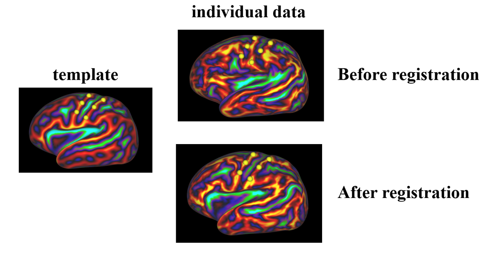
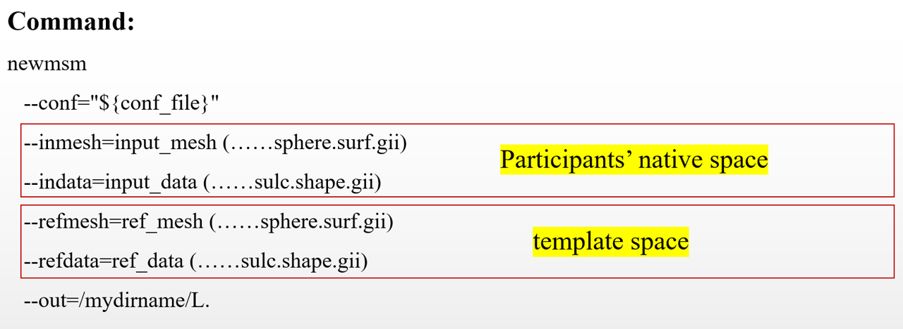
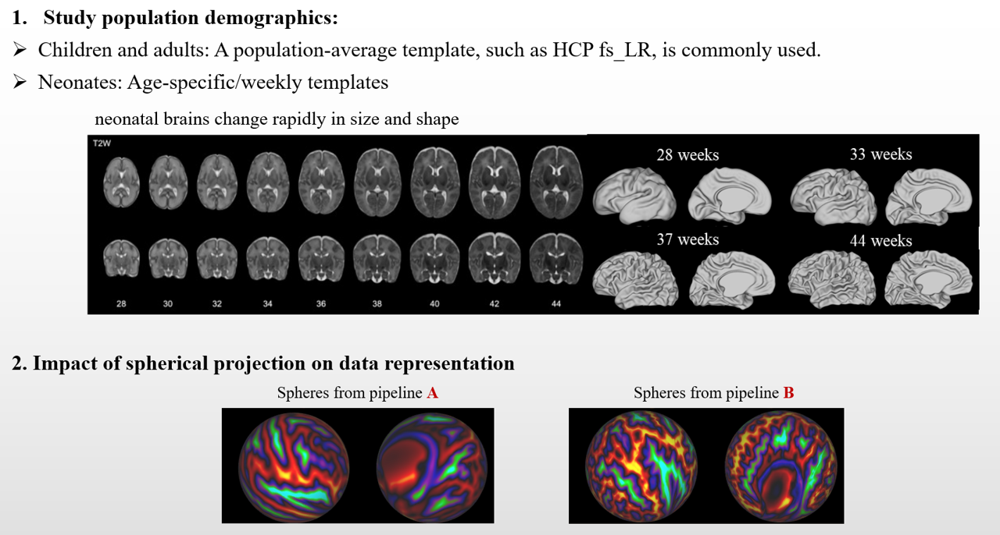
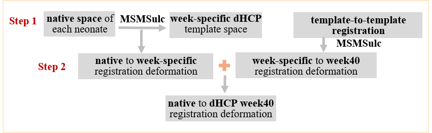

# MSMSulc Surface Registration Tutorial

## 1. Why do we need surface registration?

Surface registration aligns individual cortical surfaces to a common template, ensuring anatomical correspondence across subjects for group-level comparisons. **MSMSulc** uses sulcal depth, reflecting cortical folding/shape, to drive registration.



Sulcal depth on the template space (left) and an individual data before and after registration to the template (right). The yellow dots mark vertices corresponding to the precentral and postcentral gyri in the template. Before registration, the same vertices do not correspond to the same anatomical landmarks in the individual brain. After registration, they are aligned with these landmarks. Now you can have a feel on how surface registration works.

## 2. What do we need for MSMSulc?

- **Configuration file:** Registration parameters.
- **Individual data:** Native-space sphere and sulcal depth map.
- **Reference template:** Template sphere and sulcal depth map.



Running MSMSulc is quite straightforward. We use a predefined configuration file containing the registration parameters and specify an output directory. We then provide the individual's native-space sphere and sulcal depth map, along with a reference template containing the template sphere and sulcal depth map. The key question is: How do we choose a suitable reference template?

### How to select a suitable template



There are two main things to consider when choosing a reference template.
One is study population and age. For children and adults, we usually use a population-average template, as cortical size and folding patterns are relatively stable compared with neonates. However, neonatal brains develop rapidly, with substantial changes in cortical size and folding patterns from week to week. Therefore, for neonatal data, we usually use week-specific templates that closely match the infant's scan age.
Another consideration is spherical projection. In surface analysis pipeline, cortical surfaces are mapped onto spheres for registration. However, this projection introduces some distortion, which can affect vertex positions on the sphere. Different surface reconstruction pipelines may use different spherical projection methods, resulting in different spherical representations. For example, the spheres generated by pipelines A and B look quite different, particularly in the size of the medial wall. These differences can affect registration quality when aligning surfaces generated by different pipelines. Therefore, it is important to check the compatibility of spherical projections before registration.
In the field of neuroimaging, many commonly used neuroimaging pipelines follow HCP-style surface processing conventions, which can improve compatibility, although spherical projections are not necessarily identical across pipelines.

## 3. Practical exercises

1. Run MSMSulc registration on childhood and neonatal data.
2. Perform visual quality control (QC) of the registration.

### Practice 1: MSMSulc registration for childhood data

All required files are provided in `./data/MSMsulc/`.

| File | Description |
|---|---|
| `config_MSMsulc` | Registration configuration |
| `child.L.sulc.native.shape.gii` | Individual sulcal depth |
| `child.L.sphere.rot.native.surf.gii` | Individual native sphere |
| `HCP.refsulc.left.LR.32k_fs_LR.shape.gii` | HCP template sulcal depth |
| `HCP.left.sphere.32k_fs_LR.surf.gii` | HCP template sphere |

HCP templates are also available [here](https://github.com/Washington-University/HCPpipelines/tree/9c37f2581ca24e71e42a143ad63d6ab88bd493c3/global/templates/standard_mesh_atlases).

**Run MSMSulc:**

```bash
newmsm --conf=./data/MSMsulc/config_MSMsulc \
       --indata=./data/MSMsulc/child.L.sulc.native.shape.gii \
       --inmesh=./data/MSMsulc/child.L.sphere.rot.native.surf.gii \
       --refdata=./data/MSMsulc/HCP.refsulc.left.LR.32k_fs_LR.shape.gii \
       --refmesh=./data/MSMsulc/HCP.left.sphere.32k_fs_LR.surf.gii \
       --out=./data/MSMsulc/child_MSMsulc_output/left.child.
```

### Check MSMSulc outputs

The main outputs include:

| Output | Description |
|---|---|
| `left.child.sphere.LR.reg.surf.gii` | Registered sphere in reference spherical coordinates |
| **`left.child.sphere.reg.surf.gii`** | Registered native sphere, used to **resample cortical surfaces and metrics** |
| **`left.child.transformed_and_reprojected.func.gii`** | Registered sulcal depth map, useful for **registration QC** |

**Visual QC:**

Open the registered sulcal depth map and reference sulcal depth map in Connectome Workbench. Check whether major sulci and gyri are well aligned.

**Tutorial on how to apply registration to surface meshes and metrics:** [Connectome Workbench: Surface/metrics resampling](https://www.youtube.com/watch?v=IA4j3Md-2CQ&list=PLc95HdN2_wt9UEjeDDFF1bdRHDKzcsW4b&index=3)
This video introduces useful commands:
- `wb_command -surface-resample`: Resample cortical surface meshes.
- `wb_command -metric-resample`: Resample cortical metrics.
- `wb_command -surface-sphere-project-unproject`: Inverse registration or Concatenate spherical transformations, including the two-step neonatal registration below.

### Practice 2: MSMSulc registration for neonatal data

Neonatal registration requires additional consideration because cortical folding changes rapidly with age.

Here, we use a **two-step registration**:

1. Register the individual neonate to an age-matched template (the provided neonatal data were scanned at 43 weeks).
2. Combine this registration with a pre-generated week43-to-week40 transformation to obtain a registered sphere in the common dHCP week40 template space.



Two-step neonatal registration: individual native sphere → week43 template → week40 template.

**Step 1. Register the neonate to the week43 template**

Age-specific templates are provided in: `./data/MSMsulc/neonatal_template/LR_week_templates/`

```bash
newmsm --conf=./data/MSMsulc/config_MSMsulc \
       --indata=./data/MSMsulc/neonateWeek43_hemi-left_sulc.shape.gii \
       --inmesh=./data/MSMsulc/neonateWeek43_hemi-left_sphere.rot.surf.gii \
       --refdata=./data/MSMsulc/neonatal_template/LR_week_templates/week43_left_sulc_LR.32k.shape.gii \
       --refmesh=./data/MSMsulc/neonatal_template/LR_week_templates/week43_left_LR.32k.sphere.surf.gii \
       --out=./data/MSMsulc/neo_MSMsulc_output/left.neo.
```

**QC:** Inspect the registered sulcal depth map against the week43 template, as in Practice 1.

**Step 2. Combine the registration with the week43-to-week40 transformation**

The pre-generated template-to-template registration is provided in: `./data/MSMsulc/neonatal_template/template_to_template/`

```bash
wb_command -surface-sphere-project-unproject \
    ./data/MSMsulc/neo_MSMsulc_output/left.neo.sphere.reg.surf.gii \
    ./data/MSMsulc/neonatal_template/LR_week_templates/week43_left_LR.32k.sphere.surf.gii \
    ./data/MSMsulc/neonatal_template/template_to_template/dHCPtemplate_left_week43To40.sphere.reg.surf.gii \
    ./data/MSMsulc/neo_MSMsulc_output/left.neo.sphere.regToweek40.surf.gii
```

**Command inputs:**

| Argument | Description |
|---|---|
| left.neo.sphere.reg.surf.gii | Individual sphere registered to week43 |
| week43_left_LR.32k.sphere.surf.gii | Week43 template sphere |
| dHCPtemplate_left_week43To40.sphere.reg.surf.gii | Week43 sphere registered to week40 |
| left.neo.sphere.regToweek40.surf.gii | Output sphere registered to week40 |

**Final output:** `left.neo.sphere.regToweek40.surf.gii`. This sphere combines the native-to-week43 and week43-to-week40 transformations, allowing the neonatal surface data to be resampled into the common week40 template space.


### Other MSM Registration Variants: aMSM, group-wise MSM and MSMALL

**aMSM (anatomical MSM):** Used for within-individual longitudinal surface registration, such as aligning fetal to neonatal, or neonatal to childhood cortical surfaces.

**Group-wise MSM:** Registers individuals to a series of templates to better preserve individual variability during registration.

**MSMAll:** Uses multiple features, including myelin maps and functional features, to improve cortical surface registration.

**to check here for more details:** https://fsl.fmrib.ox.ac.uk/fsl/docs/registration/newmsm/guide.html


