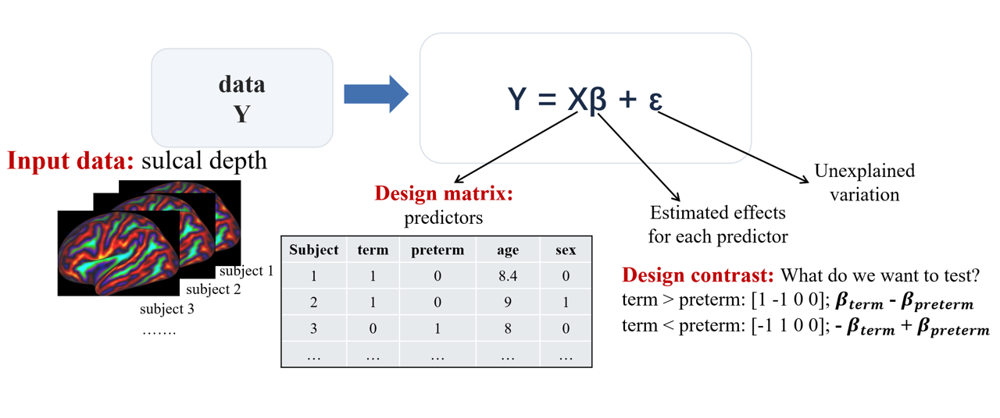

# Permutation Analysis of Linear Models (PALM)

## 1. Why do we need vertex-wise statistical analysis?

Imagine that we have two groups of neonates: **preterm** (born before 37 weeks of gestation) and **full-term**. For each neonate, we have cortical maps such as surface area, fractional anisotropy (FA), and mean diffusivity (MD). We want to know **whether these measures differ between the groups and which cortical regions show these differences.**

When comparing a single measurement, such as blood pressure between patients and healthy controls, we typically use a **two-sample *t*-test**. However, a **cortical map contains thousands of vertices**, which introduces several challenges:

1. **Multiple comparisons:** Testing each vertex separately involves thousands of statistical comparisons, increasing the risk of false positives (detecting a significant difference when no real effect exists).
2. **Spatial correlation:** Neighbouring cortical vertices are spatially correlated rather than independent.
3. **Confounding variables:** We often need to account for other variables, such as age and sex, that may influence the measurements.

This is where PALM (Permutation Analysis of Linear Models) comes in. It combines **general linear models (GLMs)**, **permutation testing**, **threshold-free cluster enhancement (TFCE)**, and **multiple-comparison correction** to perform statistical analyses of neuroimaging data.

## 2. Key statistical concepts

### 2.1. Understanding the General Linear Model (GLM)

Now let's look at how we tell PALM what we want to test.



The basic equation is:

**Y = Xβ + ε**

- **Y (data):** The measurement at one cortical vertex across all subjects, such as surface area or MD.
- **X (design matrix):** Information about each subject, such as group, scan age, and sex.
- **β (beta coefficients):** Effects estimated for the columns of the design matrix.
- **ε (error):** Variation not explained by the model.

We also need a **contrast**, which tells PALM which effect or comparison we want to test.

For example, suppose the columns of our design matrix are, in this exact order:

`[Full-term group, Preterm group, Scan age, Sex]`

Then:

| Research question | Contrast |
|---|---|
| Full-term > Preterm | `[1, -1, 0, 0]` |
| Preterm > Full-term | `[-1, 1, 0, 0]` |

The zeros indicate that **scan age and sex are included as covariates in the model**, but their effects are not being tested by these contrasts.

**Remember:** The design matrix tells the model **which variables we have**; the contrast tells it **which effect we want to test**. Both are essential for running PALM and interpreting the results.

### 2.2 What is a permutation test?

The basic question is: **Could the group difference we observed have happened by chance?**

Suppose we calculate a *t*-statistic comparing preterm and full-term neonates at one cortical vertex. A permutation test asks what kinds of *t*-statistics we would see **if there were actually no group difference**.

In a simple two-group example:

1. Calculate the observed *t*-statistic using the real group labels.
2. Shuffle the group labels (under the null hypothesis) and calculate the statistic again.
3. Repeat this many times to build a **null distribution**.
4. Compare the observed statistic with this distribution. If very few permutations produce a statistic as extreme as the observed one, the result is unlikely under the null hypothesis.

In a GLM with covariates, PALM uses appropriate permutation strategies rather than simply shuffling labels in every situation. **Permutations must respect the study design and exchangeability assumptions**, particularly for repeated measures or related participants.

**Parametric vs non-parametric testing:** Familiar tests such as the *t*-test and ANOVA usually rely on parametric assumptions about the model errors. Permutation tests estimate significance from rearrangements of the data under the null hypothesis, reducing reliance on a theoretical reference distribution. However, permutation tests still have assumptions; they are not automatically valid for every dataset.

### 2.3 What is Threshold-Free Cluster Enhancement (TFCE)?

Nearby vertices often show similar effects. Instead of looking at each vertex completely in isolation, **TFCE** enhances statistical signals that are both **strong** and **spatially extended**.

- **Cluster:** A connected set of neighbouring vertices or voxels.
- **Threshold-free:** Unlike traditional cluster-based methods, TFCE does not require us to choose one arbitrary cluster-forming threshold.

TFCE produces an enhanced statistic at each vertex. PALM can then use permutations to assess significance and correct for multiple comparisons. **TFCE itself is not a multiple-comparison correction**; correction comes from the permutation-based inference applied to the TFCE statistic.

### 2.3 Why do we need multiple-comparison correction?

Imagine testing 10,000 vertices at *p* < 0.05. Even if there were no real effects, we could expect about **500 false-positive tests on average** if each test had a 5% false-positive rate.

One approach is **family-wise error rate (FWER) correction**, which controls the probability of making **at least one false-positive claim** across a specified family of tests, typically at 5%.

In this tutorial, we may need to correct across:

- **Vertices:** Thousands of locations on the cortical surface.
- **Contrasts:** For example, full-term > preterm and preterm > full-term.
- **Modalities:** Surface area and MD.

PALM can handle these levels of correction together.


## 3. Practical: Compare Surface Area and MD Between Preterm and Full-Term Neonates

All the files for this exercise are in:

`./data/PALM/`

### 4.1 Check the design matrix and contrasts

Before running PALM, open these files:

- `./data/PALM/design.mat`
- `./data/PALM/design.con`

Look for:

| Field | Meaning |
|---|---|
| `/NumWaves` in `design.mat` | Number of columns (regressors) in the design matrix. |
| `/NumPoints` in `design.mat` | Number of observations (rows). For one scan per subject, this is the number of subjects. |
| `/NumWaves` in `design.con` | Number of contrast weights, which must match the design matrix columns. |
| `/NumContrasts` in `design.con` | Number of contrasts to test. |
| `/Matrix` | Numerical values defining the design or contrasts. |

In this exercise, we compare the two groups while accounting for **scan age and sex**. You can create these files manually or use the FSL GLM setup tool. For other study designs, see [FSL GLM](https://web.mit.edu/fsl_v5.0.10/fsl/doc/wiki/GLM.html).

**Check carefully:** The subject order in the merged imaging data must match the row order in `design.mat`. Also check how age and sex are coded and whether the group columns and contrasts match the example above.

### 4.2 Run PALM

We'll test two cortical modalities together:

1. **Surface area** (`m1`)
2. **Mean diffusivity (MD)** (`m2`)

```bash
mkdir -p ./data/PALM/group_comp

palm -i ./data/PALM/left_wm_va_corr_smoothed2.10k.shape.gii \
     -m ./data/PALM/left.dHCP.10k.mask_fromHCP.shape.gii \
     -i ./data/PALM/left_DTIMD_smoothed2.10k.shape.gii \
     -m ./data/PALM/left.dHCP.10k.mask_fromHCP.shape.gii \
     -s ./data/PALM/left_average.midthickness.10k.surf.gii \
        ./data/PALM/left_average.midthickness_va_corr.10k.shape.gii \
     -d ./data/PALM/design.mat \
     -t ./data/PALM/design.con \
     -o ./data/PALM/group_comp/L_Term_Preterm \
     -T \
     -tfce2d \
     -n 20 \
     -logp \
     -corrcon \
     -corrmod
```

**Important:** `-n 20` is used **only to make the tutorial run quickly**. It is far too few permutations for meaningful inference at *p* < 0.05. For a real analysis, use many more permutations (often **5,000–10,000 or more**, depending on the design and required precision). With only 20 random permutations, the smallest attainable permutation *p*-value is typically about **1/21 ≈ 0.048**, before correction, so corrected results will be very coarse and unstable.

### 4.3 What do the PALM options mean?

The official [PALM User Guide](https://fsl.fmrib.ox.ac.uk/fsl/docs/statistics/palm/user_guide.html) is detailed. Here are the main options used in this tutorial:

| Option | What it does |
|---|---|
| `-i` | Specifies an input imaging modality. Each `.shape.gii` contains one map per subject; subjects must appear in the same order as the design matrix. |
| `-m` | Specifies the analysis mask for the corresponding input modality. Here we use a common cortical mask excluding the medial wall. |
| `-s` | Supplies the cortical surface mesh and a vertex-area metric for surface-based inference and TFCE. The area metric describes the surface area associated with each vertex; it is **not** an additional imaging modality being tested. |
| `-d` | Design matrix (`design.mat`). |
| `-t` | *t*-contrast file (`design.con`). |
| `-o` | Prefix for output filenames. |
| `-T` | Enables TFCE inference. |
| `-tfce2d` | Uses TFCE settings appropriate for 2D surface data. |
| `-n 20` | Runs 20 permutations for a quick demonstration only. |
| `-logp` | Saves *p*-value maps as `-log10(p)` rather than raw *p*-values. |
| `-corrcon` | Requests additional correction across contrasts. |
| `-corrmod` | Requests additional correction across modalities. |
| `-nouncorrected` | Optional: suppresses uncorrected *p*-value outputs. Not used in this example. |

To merge individual surface metrics into one input file, see [Workbench `-metric-merge`](https://www.humanconnectome.org/software/workbench-command/-metric-merge).

**Note:** The two `-i` options represent two modalities, not two subjects. Both files must contain the same number of subjects in the same order.

## 5. Understanding PALM Outputs

After running PALM, look in:

`./data/PALM/group_comp/`

The exact filenames depend on the PALM version and requested options, but the following parts of the names are particularly useful.

### 5.1 Raw statistics versus TFCE statistics

- **`dpv` / unenhanced statistic outputs:** Relate to the original vertex-wise statistics and their associated inference, without TFCE enhancement. PALM uses `dpv` in some output names for the distribution of *p*-values or unenhanced inference; inspect the full filename rather than treating every `dpv` file as a *t*-statistic.
- **`tfce` outputs:** Relate to TFCE-enhanced statistics and permutation inference. These are the main outputs for our TFCE analysis.
- **`tstat` outputs:** Show the original *t*-statistics, including the direction and relative strength of the estimated group effect.
- **`tfce_tstat` outputs (if generated):** Show TFCE-enhanced statistics, which are not the same as ordinary *t*-statistics.

### 5.2 What do the correction labels mean?

For PALM *p*-value outputs, common labels include:

| Label | Interpretation |
|---|---|
| `uncp` | Uncorrected *p*-values. |
| `fwep` | FWER-corrected across the spatial locations in the analysis. |
| `cfwep` | FWER-corrected across spatial locations and contrasts. |
| `mfwep` | FWER-corrected across spatial locations and modalities. |
| `mcfwep` | FWER-corrected across spatial locations, modalities, and contrasts. |

Because we specified both `-corrcon` and `-corrmod`, the **TFCE `mcfwep`** outputs are the most relevant when interpreting results corrected across both modalities and both contrasts.

**Important:** Check the actual output filenames and PALM documentation for your installed version; the labels indicate which family of tests has been corrected.

### 5.3 Which modality and contrast does each file represent?

In this example, the inputs are ordered as follows:

- **`m1`:** Surface area.
- **`m2`:** MD.

Assuming the contrasts in `design.con` are ordered as in our GLM example:

- **`c1`:** Full-term > Preterm.
- **`c2`:** Preterm > Full-term.

| Output suffix | What it tests |
|---|---|
| `m1_c1` | Surface area: Full-term > Preterm. |
| `m1_c2` | Surface area: Preterm > Full-term. |
| `m2_c1` | MD: Full-term > Preterm. |
| `m2_c2` | MD: Preterm > Full-term. |

**Exercise:** Open `design.con` and check whether these contrast directions are correct. If the contrasts are ordered differently, the interpretations above must change.

### 5.4 How do we read `-log10(p)` maps?

We used `-logp`, so the saved significance values are:

`-log10(p)`

For a conventional threshold of **p < 0.05**:

`-log10(0.05) ≈ 1.301`

Therefore, on a `-logp` map, values **greater than 1.301** correspond to *p* < 0.05. For the `mcfwep` map, this means *p* < 0.05 **after the requested FWER corrections**.

Larger `-log10(p)` values mean smaller *p*-values. They do **not** indicate a larger biological effect.

### 5.5 Visualise the results in `wb_view`

Open the relevant PALM output maps in `wb_view` and inspect the TFCE-corrected results.

If Workbench does not recognise an output GIFTI metric with a `.gii` extension, check whether it needs the appropriate `.shape.gii` naming convention. Renaming can help software identify the file type, but it does **not** convert the file's internal format.

Use a threshold of **1.301** for the `-log10(p)` maps and check which vertices survive correction.

**Questions to think about:**

1. Do the significant regions agree with our hypotheses that **preterm neonates have smaller cortical surface area and higher MD**?
2. Which maps and contrasts would support each hypothesis? *(Hint: surface area `m1_c1`; MD `m2_c2`.)*
3. If neither effect survives correction, does that prove there is no group difference? Why not?
4. What might affect statistical power? Think about sample size, measurement noise, effect size, covariates, spatial variability, and correction across many tests.
5. Can you examine the original `tstat` maps to see the **direction and spatial pattern** of the effects, even where they do not survive correction?

**Be careful:** A visible pattern in a *t*-statistic map is not necessarily statistically significant. The original `tstat` map is useful for exploring effect direction; the TFCE-corrected *p*-value maps tell us which results meet the chosen significance threshold. Also, `-n 20` is only a software demonstration: do not draw scientific conclusions from its corrected *p*-values.

## 6. Key Takeaways

- **GLM:** Defines the predictors and comparisons we want to test.
- **Permutation testing:** Estimates how unusual the observed statistic is under the null hypothesis.
- **TFCE:** Enhances spatially extended statistical signals without requiring an arbitrary cluster-forming threshold.
- **FWER correction:** Helps control false positives across vertices, contrasts, and modalities.
- **PALM outputs:** Always check the modality, contrast, statistic type, and correction level before interpreting a map.

For more details, see the [official PALM User Guide](https://fsl.fmrib.ox.ac.uk/fsl/docs/statistics/palm/user_guide.html).

