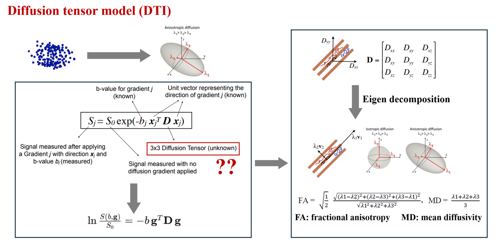
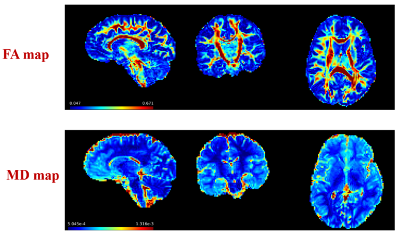

# Mapping Diffusion and Functional MRI to the Cortical Surface

## 1. Brief Introduction to Diffusion and Functional MRI

You're already quite familiar with structural MRI (sMRI), which we mainly use to study brain anatomy and macrostructure. Two other commonly used MRI modalities are diffusion MRI (dMRI) and functional MRI (fMRI). Briefly, dMRI looks at how water molecules move within brain tissue. Because this movement is influenced by tissue microstructure, we can use it to study white matter and cortical microstructural properties. The fMRI is a bit different. It measures changes in blood oxygenation over time, which indirectly reflect neural activity. We can use it to study brain activity and functional connectivity between different brain regions.

Let's briefly look at how they differ.

| | Structural MRI (sMRI) | Diffusion MRI (dMRI) | Functional MRI (fMRI) |
|---|---|---|---|
| **Data** | **3D**: a single brain volume | **4D**: a series of volumes acquired with different diffusion weightings and directions | **4D**: a series of volumes acquired over time |
| **Imaging principle** | Measures differences in tissue relaxation properties to distinguish brain tissues | Measures the movement of water molecules in brain tissue | Measures changes in blood oxygenation (BOLD signal) associated with neural activity |
| **Applications** | Regional brain volume, cortical thickness, surface area, sulcal depth | White matter connectivity, cortical microstructure | functional connectivity |
| **Preprocessing** | Bias field correction, brain extraction | Bias field correction, brain extraction, **denoising, motion and distortion correction** | Bias field correction, brain extraction, **denoising, motion and distortion correction** |

### Understanding 4D dMRI and fMRI Data

For **dMRI**, the 4th dimension represents different diffusion-weighted measurements, with different diffusion weightings (**b-values**) and gradient directions (**b-vectors**). For **fMRI**, the 4rth dimension represents time, allowing us to track changes in brain signals over time. Let's take a closer look at how dMRI works and what these acquisition parameters mean, as they are essential for dMRI preprocessing. In comparison, fMRI data are more straightforward to understand as a series of brain volumes acquired over time, so we won't go into further detail here.


*Figure adapted from [FSL Course Materials](https://pages.fmrib.ox.ac.uk/fslcourse/website/online_materials.html).*

**1) How does water diffuse in the brain:** Water molecules move randomly in brain tissue, but their movement is influenced by tissue structures. For example, in white matter, water tends to diffuse more easily along nerve fibres than across them. We call this **anisotropic diffusion**. By measuring how much water diffuses and whether it has a preferred direction, we can infer properties of the underlying tissue microstructure.

**2) How does MRI measure water diffusion:** Diffusion MRI uses diffusion-sensitive magnetic field gradients to measure water movement. Water diffusion causes changes in the MRI signal, with greater diffusion generally producing greater signal attenuation for a given diffusion weighting. We acquire a series of brain volumes using different diffusion parameters:
- **b-value:** Describes how strongly the MRI signal is weighted by diffusion. It depends on the gradient strength and diffusion time.
- **b-vector:** Defines the direction along which diffusion is measured.

**Key takeaway:** When working with dMRI, always check that you have the **4D diffusion image** and its corresponding **b-value (`.bval`) and b-vector (`.bvec`) files**. These files contain essential acquisition information, and without valid, matching information, you cannot preprocess or analyse the diffusion data.

### Preprocessing

One important thing to know is that **diffusion and functional MRI are usually acquired using EPI sequences, which are particularly sensitive to image distortions.** So, compared with structural MRI, they usually require additional preprocessing, especially **motion and distortion correction.** The figure below shows raw MRI data from three modalities acquired on a 3T MRI scanner.


### Useful References and Preprocessing Pipelines

This tutorial won't focus on dMRI/fMRI preprocessing, but here are some useful references and links to commonly used preprocessing pipelines. One thing to keep in mind is that **neonatal MRI data usually require different preprocessing pipelines from childhood and adult data**, due to differences in brain development and imaging characteristics. The pipelines listed below are widely used in neuroimaging research. They follow broadly similar principles but may differ in specific processing steps. The choice of pipeline depends on your data and research needs.

### 1) sMRI

**Neonates:**
- Makropoulos, Antonios et al. “The developing human connectome project: A minimal processing pipeline for neonatal cortical surface reconstruction.” *NeuroImage* vol. 173 (2018): 88–112. doi:10.1016/j.neuroimage.2018.01.054      **the original dHCP structural pipeline, including drawEM segmentation, surface reconstruction and feature generation**  
  [https://github.com/biomedia/dhcp-structural-pipeline](https://github.com/biomedia/dhcp-structural-pipeline)

- Ma, Qiang et al. “The Developing Human Connectome Project: A fast deep learning-based pipeline for neonatal cortical surface reconstruction.” *Medical Image Analysis* vol. 100 (2025): 103394. doi:10.1016/j.media.2024.103394      **the deep learning-based pipeline (faster than the original one), including surface reconstruction and feature generation**  
  [https://github.com/m-qiang/dhcp-dl-neonatal](https://github.com/m-qiang/dhcp-dl-neonatal)

**Children and adults:**
- **FreeSurfer (`recon-all`):** surface reconstruction and feature generation [https://surfer.nmr.mgh.harvard.edu/fswiki/recon-all](https://surfer.nmr.mgh.harvard.edu/fswiki/recon-all)
- **ciftify:** to convert freesurfer outputs to HCP-style outputs for visualization and surface registration [https://edickie.github.io/ciftify/#/](https://edickie.github.io/ciftify/#/)

### 2) dMRI

**Neonates:**
- Bastiani, Matteo et al. “Automated processing pipeline for neonatal diffusion MRI in the developing Human Connectome Project.” *NeuroImage* vol. 185 (2019): 750–763. doi:10.1016/j.neuroimage.2018.05.064  
  [https://git.fmrib.ox.ac.uk/matteob/dHCP_neo_dMRI_pipeline_release](https://git.fmrib.ox.ac.uk/matteob/dHCP_neo_dMRI_pipeline_release)

**Children and adults:**
- **QSIPrep:** Cieslak, Matthew et al. “QSIPrep: an integrative platform for preprocessing and reconstructing diffusion MRI data.” *Nature Methods* vol. 18,7 (2021): 775–778. doi:10.1038/s41592-021-01185-5  
  [https://github.com/PennLINC/qsiprep](https://github.com/PennLINC/qsiprep)

**General diffusion MRI preprocessing software** (Most of the neonatal and adult preprocessing pipelines listed above directly call commands from the software listed below.):
- **FSL TOPUP/EDDY:** [https://fsl.fmrib.ox.ac.uk/fsl/docs/diffusion/index.html](https://fsl.fmrib.ox.ac.uk/fsl/docs/diffusion/index.html)
- **MRtrix SHARD reconstruction:** [https://github.com/dchristiaens/shard-recon](https://github.com/dchristiaens/shard-recon)

### 3) fMRI

**Neonates:**
- Fitzgibbon, Sean P et al. “The developing Human Connectome Project (dHCP) automated resting-state functional processing framework for newborn infants.” *NeuroImage* vol. 223 (2020): 117303. doi:10.1016/j.neuroimage.2020.117303  
  [https://git.fmrib.ox.ac.uk/seanf/dhcp-neonatal-fmri-pipeline](https://git.fmrib.ox.ac.uk/seanf/dhcp-neonatal-fmri-pipeline)

**Children and adults: Both pipelines follow broadly similar fMRI preprocessing steps**
- **HCP fMRI pipeline:** Supports preprocessing of multiple MRI modalities, including structural and functional MRI.
  Glasser, Matthew F et al. “The minimal preprocessing pipelines for the Human Connectome Project.” NeuroImage vol. 80 (2013): 105-24. doi:10.1016/j.neuroimage.2013.04.127   [https://github.com/Washington-University/HCPpipelines](https://github.com/Washington-University/HCPpipelines)
- **fMRIPrep:** Focuses on functional MRI preprocessing
  Esteban, Oscar et al. “fMRIPrep: a robust preprocessing pipeline for functional MRI.” *Nature Methods* vol. 16,1 (2019): 111–116. doi:10.1038/s41592-018-0235-4  
  [https://github.com/poldracklab/fmriprep](https://github.com/poldracklab/fmriprep)


## 2. Volume-to-Surface Mapping

### What Do We Map from dMRI and fMRI to the Cortical Surface?

From the previous lecture, we already know the advantages of surface-based analysis for studying the cerebral cortex. We can measure cortical macrostructural properties, such as cortical thickness and sulcal depth, directly on the surface. Now, we also want to map **microstructural measures from dMRI** and **functional signals from fMRI** onto the cortical surface.
- **fMRI:** We usually map the preprocessed BOLD signal at each time point onto the cortical surface. This gives us a time series of functional signals at each cortical vertex.
- **dMRI:** It's a little different. Rather than directly mapping raw diffusion-weighted images, we first fit diffusion models to the preprocessed dMRI data to derive quantitative measures that reflect tissue microstructural properties. We then map these diffusion metrics onto the cortical surface.

The figure below shows how we derive diffusion metrics using one of the simplest and most commonly used models: **diffusion tensor imaging (DTI)**.



*Figures adapted from [FSL Course Materials](https://pages.fmrib.ox.ac.uk/fslcourse/website/online_materials.html). Additional reference: [Psychoradiology](https://academic.oup.com/psyrad/article/1/4/257/6485110).*

The diffusion tensor model represents water diffusion within each voxel as an ellipsoid. The tensor itself is a **3 × 3 matrix**. **Left side of the figure:** The equation describes how the diffusion-weighted MRI signal relates to water diffusion:
- **S:** Diffusion-weighted MRI signal.
- **S₀:** Baseline signal without diffusion weighting (b = 0).
- **b:** Diffusion weighting, determined by the strength and timing of the diffusion gradients.
- **g (or x):** Direction along which diffusion is measured.
By fitting this equation to measurements acquired with different diffusion directions, we can estimate a **3 × 3 diffusion tensor** for each voxel.

**Right side of the figure:** Once we have the diffusion tensor, we can perform **eigen decomposition** to obtain three eigenvalues and their corresponding eigenvectors. A simple way to understand eigen decomposition is to imagine rotating the coordinate system so that it aligns with the three principal axes of the diffusion ellipsoid.
- **Eigenvectors:** Describe the three principal diffusion directions.
- **Eigenvalues (λ₁, λ₂, λ₃):** Describe how much water diffuses along each of these directions.

We can then use these eigenvalues to calculate several commonly used diffusion metrics:
- **FA (Fractional Anisotropy):** Measures how directional water diffusion is. FA ranges from 0 (isotropic diffusion) to 1 (highly anisotropic diffusion).
- **MD (Mean Diffusivity):** The average of the three eigenvalues, reflecting overall water diffusivity.

The figure below shows example voxel-wise FA and MD maps generated using FSL's `dtifit` tool.



Now that we have these voxel-wise diffusion metrics, we can start mapping them onto the cortical surface.


### Practice: Mapping dMRI Metrics onto the Cortical Surface

In this section, we'll use Connectome Workbench (`wb_command`) to map diffusion MRI metrics onto the cortical surface. We'll use **mean diffusivity (MD)** derived from DTI as an example. The main steps are:

1. Transform the cortical surfaces from structural MRI space to diffusion MRI space.
2. Map the diffusion metric from the volume to the cortical surface.
3. Fill missing values using surface dilation.
4. Smooth the surface metric.
5. Check the results in `wb_view`.

### 1) Transform Cortical Surfaces into Diffusion MRI Space

Before mapping diffusion metrics onto the cortical surface, we need to make sure the cortical surfaces and diffusion images are in the **same space**. Here, our cortical surfaces were reconstructed from structural MRI (T2w), while the diffusion metrics are in diffusion MRI space. We'll use `wb_command -surface-apply-affine` to transform three cortical surfaces into diffusion MRI space:
- **White matter surface:** Defines the boundary between cortical grey matter and white matter.
- **Pial surface:** Defines the outer boundary of the cerebral cortex.
- **Midthickness surface:** Lies approximately halfway between the white matter and pial surfaces.

We need all three surfaces for the following ribbon-constrained volume-to-surface mapping.

**Commands:**

```bash
# Transform the midthickness surface
wb_command -surface-apply-affine \
    ./data/volume2surface/dMRI/left_midthickness.surf.gii \
    ./data/volume2surface/dMRI/T2w_to-dwi_mode-image.mat \
    ./data/volume2surface/dMRI/outputs/left_midthickness_diffspace.surf.gii \
    -flirt ./data/volume2surface/dMRI/T2w_restore_brain.nii.gz \
           ./data/volume2surface/dMRI/dMRI_mean.nii.gz

# Transform the pial surface
wb_command -surface-apply-affine \
    ./data/volume2surface/dMRI/left_pial.surf.gii \
    ./data/volume2surface/dMRI/T2w_to-dwi_mode-image.mat \
    ./data/volume2surface/dMRI/outputs/left_pial_diffspace.surf.gii \
    -flirt ./data/volume2surface/dMRI/T2w_restore_brain.nii.gz \
           ./data/volume2surface/dMRI/dMRI_mean.nii.gz

# Transform the white matter surface
wb_command -surface-apply-affine \
    ./data/volume2surface/dMRI/left_wm.surf.gii \
    ./data/volume2surface/dMRI/T2w_to-dwi_mode-image.mat \
    ./data/volume2surface/dMRI/outputs/left_wm_diffspace.surf.gii \
    -flirt ./data/volume2surface/dMRI/T2w_restore_brain.nii.gz \
           ./data/volume2surface/dMRI/dMRI_mean.nii.gz
```

**Understanding the inputs:**

| Input | Description |
|---|---|
| `left_midthickness.surf.gii` | Input cortical surface in structural MRI space. |
| `T2w_to-dwi_mode-image.mat` | Affine transformation matrix from structural MRI space to diffusion MRI space. |
| `left_midthickness_diffspace.surf.gii` | Output surface transformed into diffusion MRI space. |
| `-flirt` | Tells Workbench that the transformation matrix uses FSL FLIRT conventions. |
| `T2w_restore_brain.nii.gz` | Source structural MRI image used for the FLIRT transformation. |
| `dMRI_mean.nii.gz` | Reference diffusion MRI image used for the FLIRT transformation. |

The same transformation is applied to the pial and white matter surfaces.

**Important:** The `-flirt` option requires the source and reference images associated with the transformation matrix to correctly interpret the FLIRT transformation.

**QC:** Open the transformed surfaces and diffusion image in `wb_view` to check whether the surfaces are correctly aligned with the diffusion volume.

### 2) Volume-to-Surface Mapping

Now that the cortical surfaces are in diffusion MRI space, we can map the diffusion metric onto the surface. We'll use **ribbon-constrained mapping**, which samples data from the cortical ribbon between the white matter and pial surfaces. Rather than sampling a single voxel at each vertex, this method calculates a weighted average of voxels overlapping the cortical ribbon associated with each vertex.

**Command:**

```bash
wb_command -volume-to-surface-mapping \
    ./data/volume2surface/dMRI/DTI_MD.nii.gz \
    ./data/volume2surface/dMRI/outputs/left_midthickness_diffspace.surf.gii \
    ./data/volume2surface/dMRI/outputs/left_DTIMD_raw.shape.gii \
    -ribbon-constrained \
    ./data/volume2surface/dMRI/outputs/left_wm_diffspace.surf.gii \
    ./data/volume2surface/dMRI/outputs/left_pial_diffspace.surf.gii
```

**Understanding the inputs:**

| Input | Description |
|---|---|
| `DTI_MD.nii.gz` | Input volumetric diffusion metric (mean diffusivity). |
| `left_midthickness_diffspace.surf.gii` | Midthickness surface in diffusion MRI space. |
| `left_DTIMD_raw.shape.gii` | Output surface metric containing MD values at cortical vertices. |
| `-ribbon-constrained` | Uses the cortical ribbon to calculate weighted voxel averages. |
| `left_wm_diffspace.surf.gii` | White matter surface defining the inner cortical boundary. |
| `left_pial_diffspace.surf.gii` | Pial surface defining the outer cortical boundary. |

**Optional: Restrict mapping using a volume ROI**

In practice, we often use `-volume-roi` to restrict sampling to selected voxels, such as cortical grey matter or voxels that have passed quality control.

For example:

```bash
wb_command -volume-to-surface-mapping \
    ./data/volume2surface/dMRI/DTI_MD.nii.gz \
    ./data/volume2surface/dMRI/outputs/left_midthickness_diffspace.surf.gii \
    ./data/volume2surface/dMRI/outputs/left_DTIMD_raw.shape.gii \
    -ribbon-constrained \
    ./data/volume2surface/dMRI/outputs/left_wm_diffspace.surf.gii \
    ./data/volume2surface/dMRI/outputs/left_pial_diffspace.surf.gii \
    -volume-roi ./data/volume2surface/dMRI/cortical_gm_mask.nii.gz
```

Here, `cortical_gm_mask.nii.gz` is an example filename. You would need to provide an appropriate mask in diffusion MRI space.

**Why use a volume ROI?**

It helps avoid sampling voxels outside the region of interest or voxels with unreliable measurements.

### 3) Fill Missing Values Using Surface Dilation

After volume-to-surface mapping, open the output metric in `wb_view`. You may notice some vertices with missing or zero values. This can happen when the cortical ribbon does not overlap valid voxels at every vertex, particularly when working with relatively low-resolution diffusion MRI data. We can use **surface dilation** to fill these gaps using values from nearby vertices.

**Command:**

```bash
wb_command -metric-dilate \
    ./data/volume2surface/dMRI/outputs/left_DTIMD_raw.shape.gii \
    ./data/volume2surface/dMRI/outputs/left_midthickness_diffspace.surf.gii \
    10 \
    ./data/volume2surface/dMRI/outputs/left_DTIMD_dilated.shape.gii \
    -nearest \
    -data-roi ./data/volume2surface/dMRI/left_roi.native.shape.gii
```

**Understanding the inputs and parameters:**

| Input / Parameter | Description |
|---|---|
| `left_DTIMD_raw.shape.gii` | Input surface metric before dilation. |
| `left_midthickness_diffspace.surf.gii` | Surface mesh used to calculate distances between vertices. |
| `10` | Maximum dilation distance, in millimetres, along the surface. |
| `left_DTIMD_dilated.shape.gii` | Output surface metric after dilation. |
| `-nearest` | Fills missing values using the nearest valid vertex rather than a weighted average. |
| `-data-roi` | Specifies which vertices contain valid input data. |

**Important:** The `-data-roi` mask should identify vertices with valid MD measurements, rather than simply including all cortical vertices.

If `left_roi.native.shape.gii` is a general cortical mask containing vertices with missing values, it may not be suitable as the `-data-roi` mask. In that case, you should create a separate valid-data mask.

Also, dilation does not recover the original MRI measurements. It fills missing surface values using neighbouring vertices, so the dilation distance should be chosen carefully.

### 4) Surface Smoothing

After dilation, we can smooth the surface metric to reduce local noise. Unlike volumetric smoothing, **surface smoothing follows the cortical mesh**, helping to avoid mixing signals across nearby cortical folds that are far apart along the cortical surface.

**Command:**

```bash
wb_command -metric-smoothing \
    ./data/volume2surface/dMRI/outputs/left_midthickness_diffspace.surf.gii \
    ./data/volume2surface/dMRI/outputs/left_DTIMD_dilated.shape.gii \
    2 \
    ./data/volume2surface/dMRI/outputs/left_DTIMD_smoothed.shape.gii \
    -roi ./data/volume2surface/dMRI/left_roi.native.shape.gii
```

**Understanding the inputs and parameters:**

| Input / Parameter | Description |
|---|---|
| `left_midthickness_diffspace.surf.gii` | Surface mesh used for smoothing. |
| `left_DTIMD_dilated.shape.gii` | Input metric after dilation. |
| `2` | Gaussian smoothing kernel standard deviation (sigma), in millimetres. |
| `left_DTIMD_smoothed.shape.gii` | Output smoothed surface metric. |
| `-roi` | Restricts smoothing to vertices within the specified surface ROI. |

### 5) Check the Results in `wb_view`

Now open the following three surface metrics in `wb_view`:

1. `left_DTIMD_raw.shape.gii`
2. `left_DTIMD_dilated.shape.gii`
3. `left_DTIMD_smoothed.shape.gii`

Compare them and think about:

- Where are the missing values in the raw metric?
- How does dilation fill these gaps?
- What happens to the spatial maps after smoothing?

Try using the same colour scale for all three maps so you can compare them directly. This should give you a better understanding of how dilation and smoothing work.

### 6) Exercise: Map fMRI Data onto the Cortical Surface

We can use **the same approach** to map fMRI data onto the cortical surface. The main difference is that fMRI data are 4D, containing multiple time points, whereas our diffusion metric (MD) is a single 3D volume. For this exercise, we'll use the preprocessed resting-state fMRI data:
`./data/volume2surface/fMRI/task-rest_desc-preproc_bold.nii.gz`
This is a 4D image containing 4 time points. In real fMRI datasets, there are usually hundreds of time points.

**Your task:**

Try following the same steps as the dMRI example:

1. Transform the cortical surfaces from structural MRI space into fMRI space.
2. Map the preprocessed BOLD data onto the cortical surface using ribbon-constrained mapping.
3. Apply surface dilation.
4. Smooth the surface data.
5. Open the results in `wb_view` and check outputs.

**Hint:** `wb_command -volume-to-surface-mapping` supports 4D volumes, so you can map all fMRI time points in a single command. The output surface metric will contain multiple maps, one for each time point. All the data you need are provided in:
`./data/volume2surface/fMRI/`
Have a try and see what you can generate!


