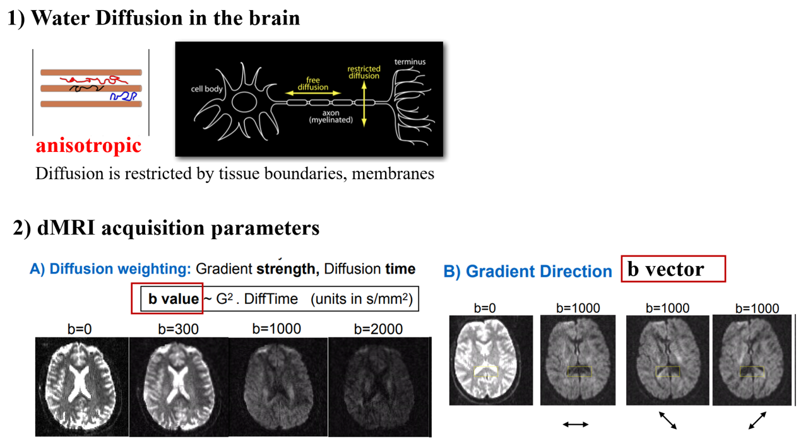
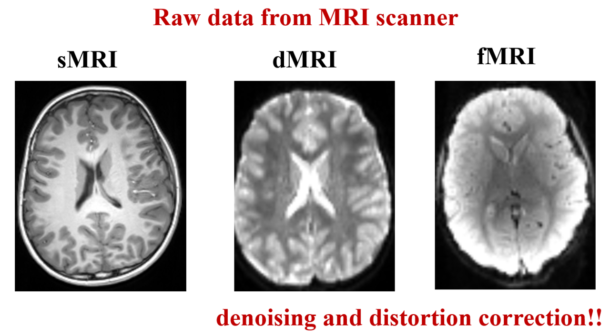

# Mapping Diffusion and Functional MRI to the Cortical Surface

## 1. Brief Introduction to Diffusion and Functional MRI

You're already quite familiar with structural MRI (sMRI), which we mainly use to study brain anatomy and macrostructure. Two other commonly used MRI modalities are diffusion MRI (dMRI) and functional MRI (fMRI). Briefly, dMRI looks at how water molecules move within brain tissue. Because this movement is influenced by tissue microstructure, we can use it to study white matter and cortical microstructural properties. The fMRI is a bit different. It measures changes in blood oxygenation over time, which indirectly reflect neural activity. We can use it to study brain activity and functional connectivity between different brain regions.

Let's briefly look at how they differ.

| | Structural MRI (sMRI) | Diffusion MRI (dMRI) | Functional MRI (fMRI) |
|---|---|---|---|
| **Data** | **3D**: a single brain volume | **4D**: a series of volumes acquired with different diffusion weightings and directions | **4D**: a series of volumes acquired over time |
| **Imaging principle** | Measures differences in tissue relaxation properties to distinguish brain tissues | Measures the movement of water molecules in brain tissue | Measures changes in blood oxygenation (BOLD signal) associated with neural activity |
| **Applications** | Regional brain volume, cortical thickness, surface area, sulcal depth | White matter connectivity, cortical microstructure | functional connectivity |
| **Preprocessing** | Bias field correction, brain extraction | Bias field correction, brain extraction, **denoising, motion and distortion correction** | Bias field correction, brain extraction, **denoising, motion and distortion correction** |

### Understanding 4D dMRI and fMRI Data

For **dMRI**, the 4th dimension represents different diffusion-weighted measurements, with different diffusion weightings (**b-values**) and gradient directions (**b-vectors**). For **fMRI**, the 4rth dimension represents time, allowing us to track changes in brain signals over time. Let's take a closer look at how dMRI works and what these acquisition parameters mean, as they are essential for dMRI preprocessing. In comparison, fMRI data are more straightforward to understand as a series of brain volumes acquired over time, so we won't go into further detail here.

*Figure adapted from [FSL Course Materials](https://pages.fmrib.ox.ac.uk/fslcourse/website/online_materials.html).*

**1) How does water diffuse in the brain?**
Water molecules move randomly in brain tissue, but their movement is influenced by tissue structures. For example, in white matter, water tends to diffuse more easily along nerve fibres than across them. We call this **anisotropic diffusion**. By measuring how much water diffuses and whether it has a preferred direction, we can infer properties of the underlying tissue microstructure.

**2) How does MRI measure water diffusion?**
Diffusion MRI uses diffusion-sensitive magnetic field gradients to measure water movement. Water diffusion causes changes in the MRI signal, with greater diffusion generally producing greater signal attenuation for a given diffusion weighting. We acquire a series of brain volumes using different diffusion parameters:
- **b-value:** Describes how strongly the MRI signal is weighted by diffusion. It depends on the gradient strength and diffusion time.
- **b-vector:** Defines the direction along which diffusion is measured.

**Key takeaway:** When working with dMRI, always check that you have the **4D diffusion image** and its corresponding **b-value (`.bval`) and b-vector (`.bvec`) files**. These files contain essential acquisition information, and without valid, matching information, you cannot preprocess or analyse the diffusion data.

### Preprocessing

One important thing to know is that **diffusion and functional MRI are usually acquired using EPI sequences, which are particularly sensitive to image distortions.** So, compared with structural MRI, they usually require additional preprocessing, especially **motion and distortion correction.** The figure below shows raw MRI data from three modalities acquired on a 3T MRI scanner.

### Useful References and Preprocessing Pipelines

This tutorial won't focus on dMRI/fMRI preprocessing, but here are some useful references and links to commonly used preprocessing pipelines. One thing to keep in mind is that **neonatal MRI data usually require different preprocessing pipelines from childhood and adult data**, due to differences in brain development and imaging characteristics. The pipelines listed below are widely used in neuroimaging research. They follow broadly similar principles but may differ in specific processing steps. The choice of pipeline depends on your data and research needs.

### 1) sMRI

**Neonates:**
- Makropoulos, Antonios et al. “The developing human connectome project: A minimal processing pipeline for neonatal cortical surface reconstruction.” *NeuroImage* vol. 173 (2018): 88–112. doi:10.1016/j.neuroimage.2018.01.054      **the original dHCP structural pipeline, including drawEM segmentation, surface reconstruction and feature generation**  
  [https://github.com/biomedia/dhcp-structural-pipeline](https://github.com/biomedia/dhcp-structural-pipeline)

- Ma, Qiang et al. “The Developing Human Connectome Project: A fast deep learning-based pipeline for neonatal cortical surface reconstruction.” *Medical Image Analysis* vol. 100 (2025): 103394. doi:10.1016/j.media.2024.103394      **the deep learning-based pipeline (faster than the original one), including surface reconstruction and feature generation**  
  [https://github.com/m-qiang/dhcp-dl-neonatal](https://github.com/m-qiang/dhcp-dl-neonatal)

**Children and adults:**
- **FreeSurfer (`recon-all`):** surface reconstruction and feature generation [https://surfer.nmr.mgh.harvard.edu/fswiki/recon-all](https://surfer.nmr.mgh.harvard.edu/fswiki/recon-all)
- **ciftify:** to convert freesurfer outputs to HCP-style outputs for visualization and surface registration [https://edickie.github.io/ciftify/#/](https://edickie.github.io/ciftify/#/)

### 2) dMRI

**Neonates:**
- Bastiani, Matteo et al. “Automated processing pipeline for neonatal diffusion MRI in the developing Human Connectome Project.” *NeuroImage* vol. 185 (2019): 750–763. doi:10.1016/j.neuroimage.2018.05.064  
  [https://git.fmrib.ox.ac.uk/matteob/dHCP_neo_dMRI_pipeline_release](https://git.fmrib.ox.ac.uk/matteob/dHCP_neo_dMRI_pipeline_release)

**Children and adults:**
- **QSIPrep:** Cieslak, Matthew et al. “QSIPrep: an integrative platform for preprocessing and reconstructing diffusion MRI data.” *Nature Methods* vol. 18,7 (2021): 775–778. doi:10.1038/s41592-021-01185-5  
  [https://github.com/PennLINC/qsiprep](https://github.com/PennLINC/qsiprep)

**General diffusion MRI preprocessing software** (Most of the neonatal and adult preprocessing pipelines listed above directly call commands from the software listed below.):
- **FSL TOPUP/EDDY:** [https://fsl.fmrib.ox.ac.uk/fsl/docs/diffusion/index.html](https://fsl.fmrib.ox.ac.uk/fsl/docs/diffusion/index.html)
- **MRtrix SHARD reconstruction:** [https://github.com/dchristiaens/shard-recon](https://github.com/dchristiaens/shard-recon)

### 3) fMRI

**Neonates:**
- Fitzgibbon, Sean P et al. “The developing Human Connectome Project (dHCP) automated resting-state functional processing framework for newborn infants.” *NeuroImage* vol. 223 (2020): 117303. doi:10.1016/j.neuroimage.2020.117303  
  [https://git.fmrib.ox.ac.uk/seanf/dhcp-neonatal-fmri-pipeline](https://git.fmrib.ox.ac.uk/seanf/dhcp-neonatal-fmri-pipeline)

**Children and adults: Both pipelines follow broadly similar fMRI preprocessing steps**
- **HCP fMRI pipeline:** Supports preprocessing of multiple MRI modalities, including structural and functional MRI.
  Glasser, Matthew F et al. “The minimal preprocessing pipelines for the Human Connectome Project.” NeuroImage vol. 80 (2013): 105-24. doi:10.1016/j.neuroimage.2013.04.127   [https://github.com/Washington-University/HCPpipelines](https://github.com/Washington-University/HCPpipelines)
- **fMRIPrep:** Focuses on functional MRI preprocessing
  Esteban, Oscar et al. “fMRIPrep: a robust preprocessing pipeline for functional MRI.” *Nature Methods* vol. 16,1 (2019): 111–116. doi:10.1038/s41592-018-0235-4  
  [https://github.com/poldracklab/fmriprep](https://github.com/poldracklab/fmriprep)

## 2. Volume-to-Surface Mapping

