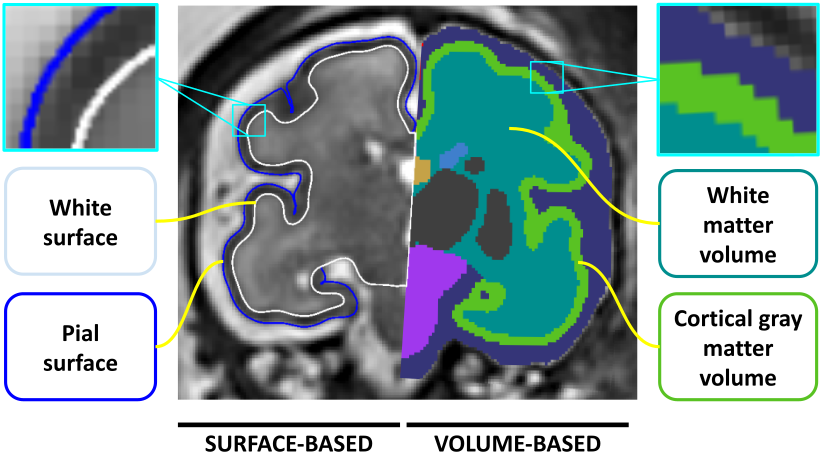
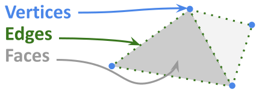
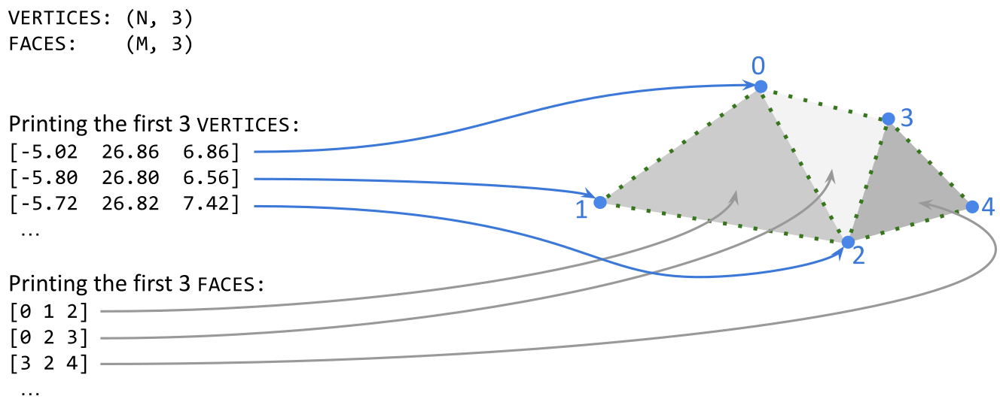
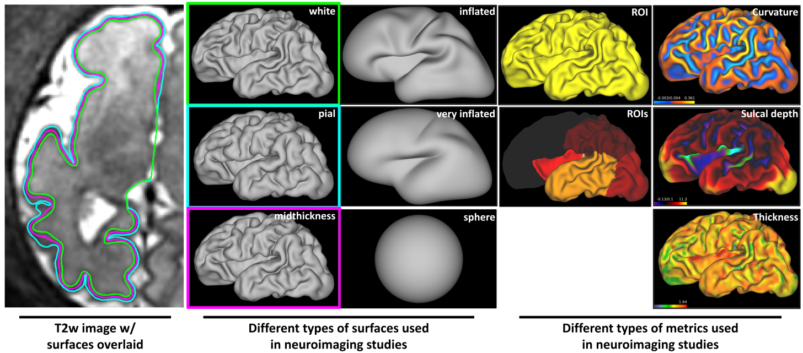
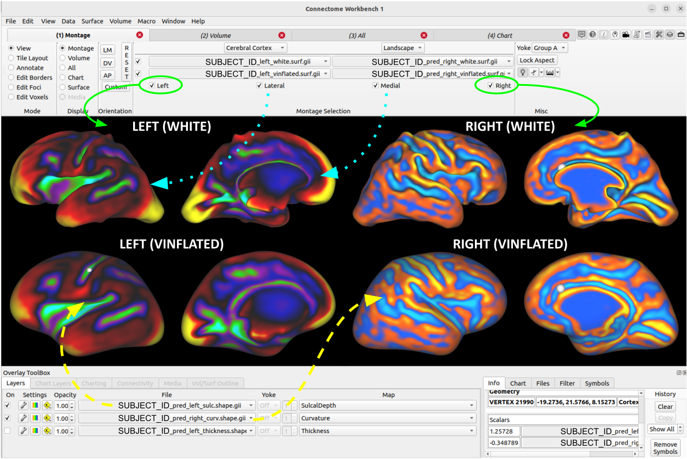
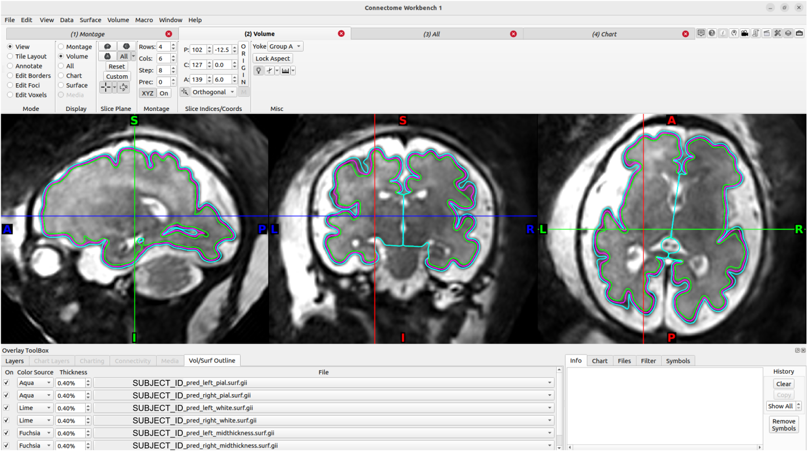
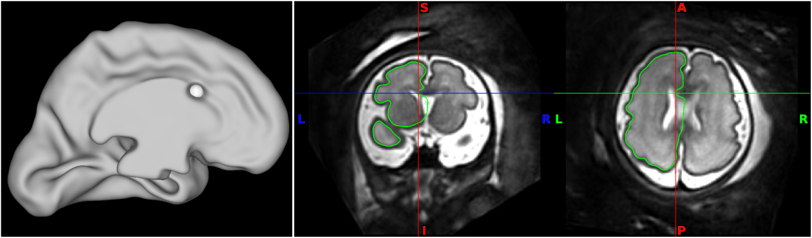
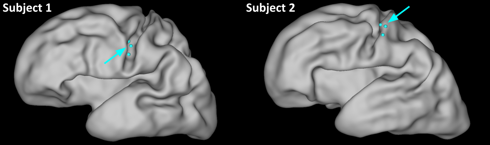
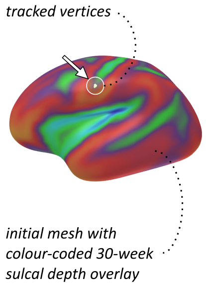
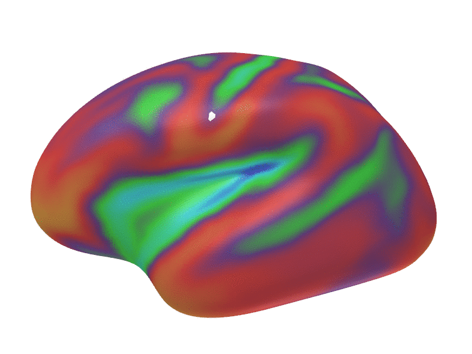

# From Voxels to Vertices: Exploring and Checking Cortical Surfaces

[← Back to all tutorials](../README.md)

## Overview

This tutorial introduces cortical surfaces: what they represent, how they
are stored, and why they are useful in neuroimaging. You will explore
surfaces using Connectome Workbench and learn to recognise common
reconstruction errors.

## Before You Start

You will need:

- Connectome Workbench installed.
- The tutorial dataset downloaded.
- A terminal and basic familiarity with navigating directories.

## Contents

1. [What Is a Cortical Surface?](#1-what-is-a-cortical-surface)
2. [Why Use Surfaces?](#2-why-use-surfaces)
3. [How Are Surfaces Represented?](#3-how-are-surfaces-represented)
4. [Exploring Surfaces in Connectome Workbench](#4-exploring-surfaces-in-connectome-workbench)
5. [Checking Surface Quality](#5-checking-surface-quality)
6. [Surface Reconstruction and Preparation for Group Analysis](#6-surface-reconstruction-and-preparation-for-group-analysis)
7. [Further Reading](#7-further-reading)


## 1. What Is a Cortical Surface?

A cortical surface is a 3D representation of a boundary of the cerebral cortex. 
Unlike an MRI volume, which represents the brain as a grid of voxels, a surface follows that boundary using a mesh of interconnected points.

Two commonly reconstructed cortical boundaries are:
- **White matter** surface: the boundary between cortical grey matter and the underlying white matter.
- **Pial** surface: the outer boundary of the cortex, adjacent to cerebrospinal fluid.

Together, these surfaces describe the cortical ribbon: the layer of cortical grey matter between them.



## 2. Why Use Surfaces?

The cortex is a thin, highly folded sheet. Surface representations let us
study its geometry and organise measurements along that sheet.

For example, two locations on opposite banks of a sulcus can be close
together in three-dimensional space but far apart when travelling along
the cortex. Surface-based methods can account for this distinction by
using the mesh connectivity.

Surfaces are useful for:

- **Measuring cortical anatomy:** including thickness, surface area,
  curvature, and sulcal depth.
- **Visualising measurements:** displaying anatomical or functional maps
  on the cortex.
- **Comparing subjects:** aligning cortical features to establish
  correspondence across brains.
- **Studying development:** examining changes in cortical shape and
  folding with age.

These benefits depend on reconstruction quality: a surface that follows
the wrong boundary can produce misleading measurements.

## 3. How Are Surfaces Represented?

### Surface and Volume Meshes

A mesh represents the geometry of an object using connected points and
elements. There are two main types:

- **Surface meshes** describe an object's boundary using two-dimensional
  polygons, usually triangles, embedded in three-dimensional space.
- **Volume meshes** represent an object's interior using three-dimensional
  elements, such as tetrahedra or hexahedra.



In this tutorial, we focus on **triangular surface meshes** representing 
the boundaries of each cerebral hemisphere.
These cortical meshes are typically constructed as closed surfaces
topologically equivalent to a sphere: they have no open edges, holes,
or handles. 
This describes their connectivity, not their appearance: a folded cortical
surface can have the same topology as a sphere.

### Vertices and Triangular Faces

A triangular surface mesh has two main components:

- **Vertices:** points defined by three-dimensional `(x, y, z)` coordinates.
- **Faces:** triangles defined by the indices of three connected vertices.

For a mesh with **N vertices** and **M faces**, the geometry is stored as:

- An **N × 3 coordinate array**, containing the position of each vertex.
- An **M × 3 index array**, identifying the vertices that form each triangle.

For example, a face containing the indices `(0, 1, 2)` connects vertices
0, 1, and 2 to form a triangle.

The vertex coordinates determine the surface's shape, while the faces
determine its connectivity. Changing the coordinates while keeping the
faces fixed deforms the mesh without changing which vertices are connected.



### Surface Representations and Vertex-Wise Data

The shape of a surface and the data displayed on it are different types
of information. The figure below shows examples of both.

#### Surface Geometry

Different surface geometries serve different purposes:

- **White matter:** follows the boundary between cortical grey matter
  and the underlying white matter.
- **Pial:** follows the outer cortical boundary, adjacent to
  cerebrospinal fluid.
- **Midthickness:** lies approximately halfway between corresponding
  white matter and pial surfaces.
- **Inflated and very inflated:** progressively open out the folds,
  making regions buried within sulci easier to inspect.
- **Sphere:** provides a spherical representation commonly used for
  surface registration.

Inflated and spherical representations change the vertex coordinates
while preserving the mesh connectivity. Their displayed shapes do not
represent the original anatomical boundaries.

#### Vertex-Wise Maps

Measurements or labels can be attached to individual vertices and
displayed as colours on a surface:

- **Sulcal depth:** describes how deeply a location lies within the
  cortical folds relative to a reference surface.
- **Curvature:** describes local bending of the surface.
- **Thickness:** estimates the distance between the white matter and
  pial boundaries.
- **Regions of interest (ROIs):** assign vertices to anatomical or
  other defined regions.

The definitions and sign conventions of these measurements depend on
the processing method. Always check the colour scale and the method
used to generate a map.

#### File Types

Surface geometry and vertex-wise data are commonly stored in separate
files:

| File type | Typical contents |
|---|---|
| `.surf.gii` | Vertex coordinates and triangular faces |
| `.shape.gii` or `.func.gii` | Numeric values associated with vertices |
| `.label.gii` | Anatomical or other categorical labels associated with vertices |

A vertex-wise map must match the surface's vertex ordering and
correspondence. Two files having the same number of vertices does not
guarantee that they belong together.




## 4. Exploring Surfaces in Connectome Workbench

Connectome Workbench provides tools for viewing neuroimaging data. In this tutorial, we use wb_view, its graphical viewer, to explore cortical surfaces and the measurements displayed on them.

### Launch the viewer

Open a terminal and run:

`wb_view`

Or, more simply, open using a specification file:

`wb_view subject-1/tutorial-1.wb.spec` (29.7w)

A specification file contains references to the data files that are to be open:
```xml
<?xml version='1.0' encoding='UTF-8'?>
<CaretSpecFile Version="1.0">
   <MetaData />
   <DataFile Structure="CortexLeft" DataFileType="SURFACE" Selected="true">SUBJECT_ID_left_white.surf.gii</DataFile>
   ...   
   <DataFile Structure="CortexLeft" DataFileType="METRIC" Selected="true">SUBJECT_ID_left_thickness.shape.gii</DataFile>
   ...   
   <DataFile Structure="Invalid" DataFileType="VOLUME" Selected="true">SUBJECT_ID_T2w.nii.gz</DataFile>
</CaretSpecFile>
```



### Explore the surface

Using File → Open, load the supplied surface files. Select the white matter surface and inspect it from different directions.

Try it:
1. Rotate the surface and zoom into a sulcus.
2. Inspect lateral and medial views.
3. Switch between the white matter and pial surfaces.
4. Switch to the inflated surface.

#### Think about:
Which regions are easier to inspect on the inflated surface? What anatomical information is clearer on the original surface?

#### Display a surface map
1. Load the supplied curvature or sulcal depth map and select it in the overlay controls.
2. Inspect the colour bar before interpreting the image. Check which measurement is displayed, its units where applicable, and the range represented by the colours.
3. Find a region with relatively high values and one with relatively low values. Switch between anatomical and inflated surfaces while displaying the same map.
4. Let's repeat the same steps for `wb_view subject-2/tutorial-2.wb.spec` (33.4w) and try to use the sphere as well.

## 5. Checking Surface Quality

A smooth-looking surface is not necessarily an accurate reconstruction. Quality control requires checking both the mesh geometry and its agreement with the underlying MRI.

Let's open `wb_view subject-3/tutorial-3.wb.spec` (31.4w)

### Compare the surface with the MRI

Display the T2w image with surface outlines and inspect several slices in different orientations.
Check whether:
- The white matter surface follows the grey–white matter boundary.
- The pial surface follows the outer cortical boundary.
- The surfaces avoid extending into neighbouring tissues.
- Now try the same but with the segmentation map instead of the T2w image.

*Note: Some geometric problems, such as small self-intersections, can be difficult to detect visually and may require automated checks.*



### Inspect the three-dimensional geometry

Let's now open `wb_view subject-4/tutorial-4.wb.spec` (29.3w)

Try:
- Rotate the surface and look for unexpected spikes, bridges, irregular patches, or other local distortions. 
- Inspect suspicious regions in the MRI to understand whether the problem originates in the image, segmentation, or reconstruction.
- What do you notice immediately in this example? 
- Click on the problem and identify it in the MRI slice.
- Discuss: what could have caused this issue?



### Exercise: can you spot the problem?

Compare the supplied examples:
1. `wb_view subject-5/tutorial-5.wb.spec` (29.1w)
2. `wb_view subject-6/tutorial-6.wb.spec` (36.7w)

For each example, answer:
1. Where is the suspicious region?
2. Which surface or boundary is affected?
3. What does the corresponding MRI show?
4. How could the error influence a measurement such as thickness or sulcal depth?

## 6. Surface Reconstruction and Preparation for Group Analysis

Surface reconstruction creates a mesh that follows an individual subject's
cortical boundary. Before comparing measurements across subjects, we also
need to establish which cortical locations correspond.

### How Are Cortical Surfaces Generated?

Reconstruction methods generally use an MRI image, a tissue segmentation,
or both to identify cortical boundaries. Two broad approaches differ in
how they initialise the mesh.

#### Methods Using a Shared Template

Template-based methods start from a common initial mesh and deform its
vertices towards each subject's cortical boundary.

Using the same template preserves vertex indices and mesh connectivity
across subjects. However, matching the boundary alone does not guarantee
that each vertex reaches the same anatomical feature.

Let's look at an example: run `wb_view subject-7/tutorial-7.wb.spec` 
which will open two subjects' left hemisphere white matter surfaces,
both scanned around 30 weeks. 
Make sure you select both surfaces and then click in and around the central sulcus: what happens?



The animations below show the same initial mesh (see below) deforming towards the
anatomy of two fetal subjects scanned at approximately 30 weeks.
A selected vertex and the template sulcal depth map allow us
to follow how locations on the initial mesh move during reconstruction.



**Before registration**, tracked vertices reach different anatomical
locations across subjects: for example, opposite banks of the central
sulcus. The propagated map also fails to align with the subjects'
folding patterns. Although the reconstructed boundaries may be accurate,
matching vertex indices do not provide reliable anatomical correspondence.

**After registration**, the tracked locations and propagated map should
ideally be aligned with corresponding cortical features. This illustrates
the correspondence needed for meaningful vertex-wise comparisons.

| | Before registration | After registration |
| :--- | :--- | :--- |
| **Subject 1** |  |  |
| **Subject 2** |  |  |

**Take-home message:** Shared vertex indices and connectivity do not
automatically imply shared anatomical locations.

#### Methods Without a Shared Template

Other methods extract an initial mesh independently from each subject's
image or segmentation, then refine it to follow the cortical boundary.

These meshes can have different numbers of vertices and different
connectivity. Vertex indices are assigned during mesh construction:
vertex 100 in one subject has no inherent relationship to vertex 100
in another.

Let's now look at the same two subjects as before, but their surfaces have been reconstructed with a different method.
Open the files by running `wb_view subject-8/tutorial-8.wb.spec` 

- What happened? Why?
- Goto Surface → Information and write down the number of vertices and the number of faces.
- Now open the other surface separately `wb_view subject-8/[replace_with_subject_filename].surf.gii` and do the same as above.

**Exercise: does a common mesh resolution solve the problem?**

Resample both subjects' surfaces onto an **ico-6 mesh**, containing
40,962 vertices and 81,920 triangular faces per hemisphere.

Open a terminal and write the following commands:

```
## SUBJECT's name / ID below
SUBJ=""  # replace with the name of the subject here
## The reference mesh we want to resample to, i.e. the ico-6 sphere
REF_MESH_ICO6="ico-6.surf.gii"

## Filename of the input surface
INSURF_IN="${SUBJ}.L.white.native.surf.gii"
## Filename  its corresponding sphere
SPHERE_IN="${SUBJ}.L.sphere.native.surf.gii"
## Filename of the output surface (notice I just replaced native with ico6 in the filename)
SURF_OUT_ICO6="${SUBJ}.L.white.ico6.surf.gii"

## And now, the surface resampling command:
wb_command -surface-resample \
           "${INSURF_IN}" \
           "${SPHERE_IN}" \
           "${REF_MESH_ICO6}" \
           BARYCENTRIC \
           "${SURF_OUT_ICO6}"
```

The code above only resamples the surface, but the associated metric map is still in its native resolution.
Let's fix that by running the following commnads in the same terminal as before:

```
## SUBJECT's name / ID below
SUBJ=""  # replace with the name of the subject here
## The reference mesh we want to resample to, i.e. the ico-6 sphere
REF_MESH_ICO6="ico-6.surf.gii"

## Filename  the native sphere (as above)
SPHERE_IN="${SUBJ}.L.sphere.native.surf.gii"

## Filename of the input metric
METRIC_IN="${SUBJ}.L.sulc.native.shape.gii"
## Filename of the output metric
METRIC_OUT_ICO6="${SUBJ}.L.sulc.ico6.shape.gii"

## And now, the metric resampling command:
wb_command -metric-resample \
           "${METRIC_IN}" \
           "${SPHERE_IN}" \
           "${REF_MESH_ICO6}" \
           BARYCENTRIC \
           "${METRIC_OUT_ICO6}"
```

- Repeat the commands for the second subject.

- Inspect the resampled surfaces:
  - Do the surfaces now have the same number of vertices?
  - Do matching vertices lie on corresponding cortical features?
  - What has resampling changed, and what is still missing?

Resampling onto a common ico-6 mesh gives both surfaces a common vertex
count and connectivity. However, if the spherical surfaces used for
resampling have not been anatomically registered, corresponding ico-6
vertices can still sample different anatomical locations.

**Take-home message:** A common mesh resolution does not establish
anatomical correspondence. Resampling transfers data according to a
mapping; it does not estimate anatomical alignment.

### What Processing Is Needed Before Group Analysis?

Both examples illustrate the same distinction: reconstructing an accurate
cortical boundary and establishing correspondence across subjects are
separate tasks.

Surface registration is commonly performed using spherical
representations. It estimates a mapping between cortical locations;
resampling then uses that mapping to transfer surface geometry,
measurements, or labels onto a common mesh.

### From Correspondence to Statistical Analysis

Once measurements are represented at corresponding cortical locations,
we can perform vertex-wise analyses—for example, testing associations
between cortical thickness and age or differences between groups.

Additional processing, such as surface smoothing or applying a common
analysis mask, depends on the study and statistical workflow.

The next tutorial introduces **MSM** for surface registration and
**PALM** for statistical analysis.

## 7. Further Reading

For more detailed instructions and reference material:

- [Connectome Workbench](https://www.humanconnectome.org/software/connectome-workbench) — software overview and resources.
- [Workbench Tutorial and User Guide](https://www.humanconnectome.org/storage/app/media/documentation/tutorials/Connectome_WB_Tutorial_v1.5.pdf) — detailed examples of surface and volume visualisation, based on version 1.5.
- [Workbench Command Reference](https://www.humanconnectome.org/software/workbench-command) — documentation for command-line processing tools.

--- 

## 👥 Authors
*   **Irina Grigorescu** 

*Last Updated: October 2026*
